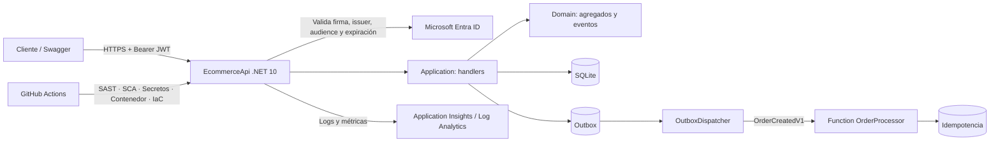

# EcommerceApi — API de referencia para AppSec y DevSecOps

API REST en .NET 10 protegida con Microsoft Entra ID y usada como banco de pruebas del portfolio: una tienda mínima donde cada puerta rechaza a quien no debe entrar. La tabla de «Estado de seguridad» separa lo probado de lo solo diseñado.

[](https://dotnet.microsoft.com/)
[](https://learn.microsoft.com/entra/)
[](https://github.com/lanuzalorenzo/lab-api-local-azure/actions/workflows/devsecops-ci.yml)
[](LICENSE)

---

## Qué es y qué no es

**Es** un laboratorio reproducible con estas capacidades:

| Capacidad | Qué demuestra |
|---|---|
| Tokens JWT de Entra ID | Validación de firma, emisor, audiencia y expiración |
| Autorización por objeto | BOLA/IDOR y separación por usuario |
| DTOs de entrada | Mitigación de *mass assignment* |
| CORS, *rate limiting* y límites | Configuración restrictiva y *Problem Details* |
| Arquitectura por capas | Regla de dependencias verificada por pruebas |
| DDD táctico | Agregados, *value objects*, invariantes y eventos de dominio |
| CQRS ligero | Modelo de escritura y proyección de lectura en pedidos |
| Persistencia SQLite | Transacciones e importes en céntimos enteros |
| Outbox transaccional | Reintentos y *dead-letter* sin perder eventos |
| Contrato y consumidor | Contrato `OrderCreatedV1` e idempotencia |
| Pruebas | Unitarias, de arquitectura, de infraestructura y de integración |
| Pipeline DevSecOps | SAST, SCA, secretos, contenedor e IaC |

**No es** un sistema listo para producción ni una implementación de microservicios: es un monolito modular con un segundo despliegue asíncrono (ver [ADR-0001](docs/adr/0001-monolito-modular-vs-microservicios.md)). Las limitaciones concretas están al final, en [Limitaciones conocidas](#limitaciones-conocidas). El estado de cada control está en [Estado de seguridad](#estado-de-seguridad).

---

## Arquitectura



La API expone dos controladores:

- `ProductsController`: catálogo de productos.
- `OrdersController`: pedidos ligados al usuario autenticado (`oid`/`sub`).

El código se organiza en cinco proyectos con una única dirección de dependencias: `Domain` ← `Application` ← `Infrastructure` ← host `EcommerceApi`, más `Contracts`, que no depende de nadie y comparten productor y consumidor. Los controladores solo conocen handlers de `Application`; los adaptadores viven en `Infrastructure`. La Function es un segundo desplegable dentro del mismo repo.

### Capas, patrones y decisiones

| Decisión | Documento | Evidencia en código |
|---|---|---|
| Monolito modular con extracción asíncrona | [ADR-0001](docs/adr/0001-monolito-modular-vs-microservicios.md) | Un despliegue HTTP; Function prevista en [docs/functions.md](docs/functions.md) |
| Regla de dependencias entre capas | [ADR-0002](docs/adr/0002-capas-y-regla-de-dependencias.md) | `tests/EcommerceApi.Architecture.Tests` |
| CQRS ligero solo en pedidos | [ADR-0003](docs/adr/0003-cqrs-ligero-en-pedidos.md) | `EcommerceApi.Application/Orders` |
| Agregado `Order` con invariantes y evento `OrderPlaced` | [ADR-0002](docs/adr/0002-capas-y-regla-de-dependencias.md) | `EcommerceApi.Domain/Orders` |
| Puertos y adaptadores (DIP) | [ADR-0002](docs/adr/0002-capas-y-regla-de-dependencias.md) | `IOrderRepository` + `SqliteOrderRepository` |
| Persistencia SQLite y outbox transaccional | [ADR-0004](docs/adr/0004-persistencia-sqlite-y-outbox.md) | `EcommerceApi.Infrastructure/Outbox` + pruebas de infraestructura |
| Contrato versionado y consumidor idempotente | [ADR-0004](docs/adr/0004-persistencia-sqlite-y-outbox.md) | `EcommerceApi.Contracts` + `functions/OrderProcessor` |

### Eventos, outbox y consumidor

1. `POST /api/orders` abre una transacción y escribe el pedido, sus líneas y el
   mensaje `OrderCreatedV1` en la tabla de outbox.
2. La transacción confirma: o existen los tres, o no existe ninguno.
3. `OutboxDispatcher` publica los pendientes cada 2 segundos. Si el publicador
   falla, incrementa el contador de intentos y deja el mensaje para el siguiente
   ciclo; tras 5 fallos lo marca como *dead-letter*.
4. La Function `OrderProcessor` consume el mensaje, valida el contrato y consulta
   `ProcessedMessages` por `messageId` antes de registrar el efecto.
5. Un mensaje repetido se reconoce sin repetir el efecto; uno inválido se lanza
   para que Service Bus lo reintente y, agotado `maxDeliveryCount`, lo mueva a la
   DLQ.

`Publisher:Mode=Log` (por defecto) registra el mensaje en el log local;
`Publisher:Mode=ServiceBus` usa un namespace real. **Service Bus y la Function no
están desplegados**: el outbox y la idempotencia se validan contra SQLite en local.

### Flujo de autorización

1. El cliente obtiene un token de Entra ID.
2. `JwtBearer` valida firma, emisor, audiencia, expiración y *clock skew*.
3. `OrdersController` resuelve la identidad del usuario y solo devuelve sus pedidos.
4. Un pedido de otro usuario responde `404` para evitar enumeración de objetos.

---

## Estado de seguridad

| Control | Estado | Evidencia |
|---|---|---|
| Validación JWT (firma, issuer, audience, lifetime) | Implementado | `EcommerceApi/Program.cs` |
| Autorización de endpoints | Implementado | `[Authorize]` en controladores |
| BOLA/IDOR en pedidos | Implementado | Filtrado por `UserId` + pruebas |
| Mass assignment en productos y pedidos | Implementado | DTOs `CreateProductRequest` / `CreateOrderRequest` |
| CORS restrictivo | Implementado | Lista vacía = denegar; allowlist por configuración |
| Rate limiting | Implementado (laboratorio) | 120 req/min por IP |
| Límite de tamaño de petición | Implementado | 16 KB en endpoints de escritura |
| `Problem Details` y cabeceras de seguridad | Implementado | `AddProblemDetails`, middleware |
| Regla de dependencias entre capas | Implementado | `tests/EcommerceApi.Architecture.Tests` (7 pruebas) |
| Pruebas unitarias de dominio y aplicación | Implementado | `tests/EcommerceApi.UnitTests` (43 pruebas) |
| Pruebas de infraestructura sobre SQLite | Implementado | `tests/EcommerceApi.Infrastructure.Tests` (7 pruebas) |
| Pruebas de integración | Implementado | `tests/EcommerceApi.Tests` (10 pruebas) |
| Persistencia transaccional | Implementado (laboratorio) | SQLite + importes en céntimos |
| Outbox transaccional y dead-letter | Implementado | `OutboxMessages`, `OutboxPublisher` y pruebas de rollback |
| Consumidor idempotente | Implementado (local) | `ProcessOrderHandler` + `ProcessedMessages` |
| Publicación en Service Bus | Diseño | `ServiceBusEventPublisher`, sin namespace desplegado |
| Function desplegada en Azure | Diseño | `functions/OrderProcessor` compila; no se ha desplegado |
| Escaneo de secretos | Implementado | Gitleaks sobre historial completo |
| SAST | Implementado | CodeQL C# (`security-extended`) |
| SCA | Implementado | Trivy filesystem, bloqueante para CRITICAL/HIGH |
| Escaneo de contenedor | Implementado | Trivy image + verificación de usuario no-root |
| IaC seguro | Implementado (plantilla) | `infra/main.bicep` + Trivy config |
| Despliegue real en Azure | Pendiente | Sin suscripción/credenciales en este repositorio |
| Scopes/roles granulares | Pendiente | Documentado en `docs/azure-ad-config.md` |
| Persistencia y alta disponibilidad | Fuera de alcance | SQLite de laboratorio, sin backups ni HA |
| OIDC de GitHub Actions a Azure | Documentado, no activo | `infra/README.md` |

> **Criterio de rigor:** «Implementado» significa que el código o la configuración
> existe y se ha ejecutado localmente o en CI. «Pendiente» significa que no se ha
> validado y no se presenta como terminado.

---

## Estructura

```text
lab-api-local-azure/
├── EcommerceApi.Domain/        # Agregados, value objects, eventos, invariantes
├── EcommerceApi.Application/   # Comandos, queries, handlers, puertos y consumidor
├── EcommerceApi.Infrastructure/# SQLite, outbox, dispatcher e idempotencia
├── EcommerceApi.Contracts/     # OrderCreatedV1 compartido con la Function
├── EcommerceApi/               # Host HTTP: controladores, auth, composición
│   ├── Configuration/          # Opciones de Entra ID
│   ├── Controllers/            # ProductsController, OrdersController
│   ├── ErrorHandling/          # DomainException -> 400
│   ├── Models/                 # DTOs de entrada
│   ├── Program.cs              # Pipeline HTTP, auth, CORS, rate limiting
│   └── appsettings.json        # Configuración sin secretos
├── functions/OrderProcessor/   # Function aislada: trigger de Service Bus
├── tests/EcommerceApi.Tests/   # Pruebas de integración xUnit (10)
├── tests/EcommerceApi.UnitTests/           # Dominio y handlers (43)
├── tests/EcommerceApi.Infrastructure.Tests/ # SQLite, outbox y dispatcher (7)
├── tests/EcommerceApi.Architecture.Tests/  # Regla de dependencias (7)
├── EcommerceApi.sln            # Solución única para build, formato y pruebas
├── data/                       # Base SQLite local (ignorada por Git)
├── infra/                      # Bicep: VNet, NSG, Key Vault, App Service, PE
├── docs/adr/                   # Decisiones de arquitectura
├── docs/                       # Autenticación, pruebas y threat model
├── .github/workflows/          # Pipeline DevSecOps
├── Dockerfile                  # Multi-stage, usuario no-root
└── README.md
```

---

## Puesta en marcha

### Requisitos

- .NET SDK 10.0
- Opcional: Docker
- Un tenant de Microsoft Entra ID para validar tokens reales

### Configuración local

```bash
cd lab-api-local-azure
cp EcommerceApi/appsettings.Development.example.json EcommerceApi/appsettings.Development.json
```

Edita `appsettings.Development.json` con tus valores:

```json
{
  "AzureAd": {
    "TenantId": "<tenant-id>",
    "ClientId": "<api-client-id>",
    "Audience": "api://<api-client-id>",
    "Authority": "https://login.microsoftonline.com/<tenant-id>/v2.0"
  },
  "Cors": {
    "AllowedOrigins": [ "http://localhost:5173" ]
  }
}
```

`appsettings.Development.json` está ignorado por Git. No guardes secretos en
`appsettings.json` ni en el repositorio.

### Ejecutar

```bash
dotnet restore EcommerceApi.sln
dotnet run --project EcommerceApi --urls http://localhost:5080
```

- Swagger (solo Development): <http://localhost:5080/swagger>
- Health check: <http://localhost:5080/health>
- API: <http://localhost:5080/api/products>
- Base de datos: `data/ecommerce.db`, creada al arrancar y **no versionada**. El
  esquema se inicializa con `CREATE TABLE IF NOT EXISTS` y se siembra el catálogo
  solo si está vacío.

### Pruebas

```bash
dotnet test EcommerceApi.sln
```

Cuatro suites, cada una con un propósito distinto:

| Suite | Qué verifica | Pruebas |
|---|---|---|
| `EcommerceApi.UnitTests` | Invariantes del dominio, handlers de aplicación e idempotencia del consumidor | 43 |
| `EcommerceApi.Architecture.Tests` | Regla de dependencias entre capas y agregados sin setters públicos | 7 |
| `EcommerceApi.Infrastructure.Tests` | Atomicidad del outbox, rollback, reintentos, dead-letter, dispatcher e idempotencia sobre SQLite real | 7 |
| `EcommerceApi.Tests` | Integración HTTP: 401, validación, *mass assignment* y BOLA entre dos usuarios | 10 |

Total: **67 pruebas**. Las de integración usan un esquema de autenticación de test
y no necesitan un tenant real; cada factory crea su propia base SQLite temporal.

### Docker

```bash
docker build -t ecommerce-api .
docker run --rm -p 8080:8080 -v ecommerce-data:/app/data ecommerce-api
```

El contenedor se ejecuta con `USER $APP_UID` (no root), escucha en `8080` y escribe
la base SQLite en `/app/data`. Sin volumen, los datos se pierden al eliminar el
contenedor.

---

## Autenticación con Entra ID

El registro de la aplicación, los scopes y las pruebas con tokens reales se
describen en:

- [`docs/azure-ad-register.md`](docs/azure-ad-register.md)
- [`docs/azure-ad-config.md`](docs/azure-ad-config.md)
- [`docs/azure-ad-tests.md`](docs/azure-ad-tests.md)

La API valida `issuer`, `audience`, `lifetime` y firma. La autorización granular
por scopes/roles está documentada como trabajo pendiente; hoy todos los endpoints
requieren un usuario autenticado y los pedidos se filtran por identidad.

### CORS

- `Cors:AllowedOrigins` vacío → se deniega cualquier origen cruzado.
- Para un frontend local, añade su origen exacto en `AllowedOrigins`.
- No se usa `AllowAnyOrigin`.

### Rate limiting

Límite global de 120 peticiones por minuto y por IP. Es un control de laboratorio;
en producción se complementaría con API Management/WAF y límites por usuario.

---

## Pipeline DevSecOps

`.github/workflows/devsecops-ci.yml` ejecuta:

| Job | Herramienta | Bloqueante |
|---|---|---|
| Compilación, formato y pruebas | .NET 10, xUnit | Sí |
| Detección de secretos | Gitleaks (historial completo) | Sí |
| SAST | CodeQL C# | Sí |
| SCA | Trivy filesystem | CRITICAL/HIGH |
| Contenedor | Docker + Trivy + verificación no-root | Sí |
| IaC | Trivy config sobre Bicep | CRITICAL/HIGH |
| Dependencias en PR | Dependency Review | High |

Los resultados SARIF se publican en la pestaña **Security → Code scanning** del
repositorio. La pipeline completa finalizó en verde el **2026-10-19** (run
`39243360276`) con las entonces 10 pruebas de integración, Gitleaks, CodeQL, Trivy
SCA, contenedor no-root, Trivy image y Trivy config sobre Bicep. La suite actual
amplía esa cobertura con pruebas unitarias, de arquitectura y de infraestructura.

---

## Infraestructura como código

`infra/main.bicep` define una arquitectura de referencia con:

- VNet segmentada (`snet-app`, `snet-pe`).
- NSG con denegación por defecto.
- Key Vault con RBAC, purge protection y acceso público deshabilitado.
- Private Endpoints y Private DNS para Key Vault y App Service.
- App Service Linux .NET 10 con HTTPS only, TLS 1.2 y FTPS deshabilitado.
- Identidad gestionada y rol *Key Vault Secrets User*.
- Diagnóstico a Log Analytics.

Consulta [`infra/README.md`](infra/README.md). **La plantilla no se ha desplegado**
en una suscripción real; se valida con `bicep build` y Trivy config en CI.

---

## Documentación de diseño

Estos documentos fijan las decisiones antes de escribir código o desplegar. El estado se indica en cada uno y no se presenta como ejecutado lo que solo está diseñado.

- [App Service](docs/app-service.md) — **Diseño**: plataforma de ejecución, Bicep frente al pipeline YAML, plan/site, entrada/salida de red, identidad, slots y coste.
- [Azure Functions](docs/functions.md) — cómputo asíncrono, idempotencia, dead-letter y hosting. **Parcial**: consumidor y outbox probados en local, sin despliegue.
- [Integración de IA](docs/ai-integration.md) — **Diseño**: gateway, controles de seguridad y evaluación.
- [Registro de decisiones (ADR)](docs/adr/README.md) — monolito modular, capas, CQRS ligero y outbox transaccional.
- [Gobernanza del repositorio](docs/repo-governance.md) — **Pendiente**: exigir PR y checks obligatorios en `main`; el push directo del 2026-10-22 los bypassó.

## Relación con el portfolio

| Módulo | Relación |
|---|---|
| [07 — DevSecOps](https://github.com/lanuzalorenzo/portfolio-ciberseguridad-lorenzo/tree/main/07-devsecops) | Pipeline, SAST, SCA, secretos e IaC |
| [08 — Redes Azure](https://github.com/lanuzalorenzo/portfolio-ciberseguridad-lorenzo/tree/main/08-seguridad-red-azure) | VNet, NSG, Private Endpoints |
| [09 — Sentinel](https://github.com/lanuzalorenzo/portfolio-ciberseguridad-lorenzo/tree/main/09-microsoft-sentinel) | Diagnóstico y analítica KQL |
| [11 — Hacking ético de APIs](https://github.com/lanuzalorenzo/portfolio-ciberseguridad-lorenzo/tree/main/11-hacking-etico-api) | BOLA/BFLA, JWT y validación ofensiva |
| [12 — Forense cloud](https://github.com/lanuzalorenzo/portfolio-ciberseguridad-lorenzo/tree/main/12-forense-cloud-respuesta) | Evidencia y respuesta en Azure |

---

## Limitaciones conocidas

- Persistencia SQLite de laboratorio: un solo escritor, sin backups ni alta
  disponibilidad; el esquema se crea con `CREATE TABLE IF NOT EXISTS`, sin
  migraciones versionadas.
- Service Bus y la Function no están desplegados: el publicador por defecto
  (`Publisher:Mode=Log`) registra el mensaje en lugar de entregarlo a un broker.
- El outbox es *at-least-once*: la garantía efectiva depende de la idempotencia del
  consumidor, que sí está probada.
- Sin microservicios: el despliegue es un monolito modular más una Function
  ([ADR-0001](docs/adr/0001-monolito-modular-vs-microservicios.md)).
- Sin scopes/roles aplicados endpoint a endpoint.
- Sin WAF/API Management desplegado.
- Sin pruebas de carga ni caos.
- La plantilla Bicep no se ha desplegado; su validación es estática.
- **Gobernanza pendiente:** el push directo del 2026-10-22 saltó la regla de PR y
  los 7 checks requeridos de `main`. Está registrado en
  [docs/repo-governance.md](docs/repo-governance.md) para cerrarlo con un PR de
  prueba y checks obligatorios.

Estas limitaciones son deliberadas y se declaran para no confundir un laboratorio
con un sistema productivo.

---

## Licencia

Distribuido bajo licencia [MIT](LICENSE).
