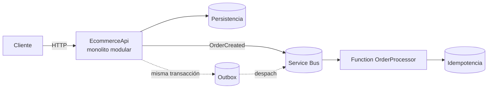

# ADR-0001 — Monolito modular con extracción asíncrona, no microservicios por defecto

> **Estado:** Aceptada · 2026-10-22
> **Ámbito:** `EcommerceApi` como workload del laboratorio final.
> **Decide:** cómo se organiza el despliegue, no cómo se organiza el código.
> **Relacionada con:** [Arquitectura de capas](0002-capas-y-regla-de-dependencias.md), [CQRS ligero](0003-cqrs-ligero-en-pedidos.md), [`docs/functions.md`](../functions.md).

## 1. Contexto

`EcommerceApi` es la carga de trabajo del laboratorio final de ciberseguridad y, a la vez, una pieza de portfolio para demostrar criterio de arquitectura. El equipo es **una persona**; hay siete repositorios activos, un curso y un laboratorio con fases de Azure pendientes de autorización y presupuesto.

El diseño ya previsto en [`docs/functions.md`](../functions.md) contempla un segundo cómputo: una Function `ProcessOrder` que consume `OrderCreated` desde Service Bus con idempotencia, reintentos y dead-letter. Es decir, la distribución ya tiene un caso de uso concreto, no una motivación estética.

La pregunta no es «¿monolito o microservicios?» en abstracto, sino **cuántas unidades desplegables necesita este sistema y por qué**.

## 2. Decisión

1. **Un repositorio** (`lab-api-local-azure`) contiene todo el código, los tests, la IaC y el pipeline.
2. **Un despliegue HTTP principal** (`EcommerceApi`), organizado internamente como **monolito modular**: dominio, aplicación e infraestructura separados por proyectos y con la regla de dependencias verificada por pruebas.
3. **Un segundo despliegue asíncrono** cuando llegue la fase de eventos: la Function `OrderProcessor`. No se parte la API en servicios por dominio.
4. Los **microservicios se obtienen por extracción justificada**, nunca por diseño inicial. Cada extracción exige una ADR nueva que explique qué se gana y qué se paga.

## 3. Alternativas consideradas

| Opción | Qué demuestra | Coste real | Veredicto |
|---|---|---|---|
| **A. Monolito clásico** | Que sabes hacer una API | Bajo | Descartada: no hay caso de distribución y el portfolio ya no aporta nada nuevo |
| **B. Monolito modular + Function asíncrona** | Fronteras de dominio, contrato versionado, idempotencia, DLQ, despliegue independiente del consumidor | Medio y acotado | **Elegida** |
| **C. Microservicios por dominio en varios repos** | Estructura de equipos grandes | Alto: N pipelines, N IaC, N auth, contratos distribuidos | Descartada para esta fase |
| **D. Serverless total** | Escala y coste por uso | Alto en diseño de estado, arranque en frío y depuración | Descartada: el objetivo es seguridad demostrable, no serverless |

### Por qué no varios repositorios

- El portfolio ya fija en [`laboratorio-final/README.md`](https://github.com/lanuzalorenzo/portfolio-ciberseguridad-lorenzo/blob/main/laboratorio-final/README.md) que no se crea un repositorio nuevo en esta fase.
- Un cambio de contrato (`OrderCreated`) y su consumidor deben viajar en el mismo commit; con polyrepo se convierte en dos PR coordinados.
- El coste marginal de cada repo (CI, IaC, Docker, auth, documentación) es alto y el beneficio en un equipo unipersonal es nulo.
- Un repositorio puede contener **varios desplegables**. Repositorio, despliegue y contexto acotado son tres dimensiones independientes.

## 4. Criterios de extracción (cuándo sí se parte)

Se extrae un servicio solo si se cumple **al menos dos** de estas condiciones y existe una ADR que lo justifique:

1. Escalado muy asimétrico respecto al resto del sistema.
2. Ciclo de despliegue independiente y estable.
3. Aislamiento de fallos obligatorio por criticidad.
4. Equipo propietario distinto con autonomía real.
5. Necesidad de un almacén o modelo de consistencia diferente.
6. Frontera de dominio estable, con contrato ya versionado.

Y no se extrae si:

- La operación comparte transacción con el resto.
- No hay observabilidad distribuida ni proceso de guardia.
- La frontera de dominio todavía cambia cada semana.
- El equipo es pequeño y el despliegue es trivial.

**Regla:** se divide por frontera de negocio y ritmo de cambio, no por tecnología.

## 5. Consecuencias

### Positivas

- Un solo pipeline y una sola IaC: menos superficie de error y de mantenimiento.
- Cambios atómicos entre contrato, productor y consumidor.
- La regla de dependencias se puede verificar en CI, no solo dibujar.
- La extracción futura queda documentada y justificada, no improvisada.

### Negativas y límites

- Un despliegue HTTP concentra el fallo: si la API cae, el catálogo y los pedidos caen juntos.
- El escalado es conjunto para todo el monolito; solo la Function escala aparte.
- No demuestra operación de microservicios reales: multi-equipo, multi-región, versionado independiente en producción ni malla de servicios.
- No hay Service Bus ni Function desplegados: la fase asíncrona se validará en local (emulador/Azurite) y el estado se declarará como **Diseño** o **Parcial** hasta que exista ejecución evidenciada.

## 6. Cuándo revisar esta decisión

- Si aparece un requisito de escala que el monolito no pueda absorber.
- Si el pipeline o el tiempo de despliegue empiezan a bloquear cambios pequeños.
- Si la Function necesita escalar o desplegarse con un ritmo claramente distinto.
- Si el laboratorio incorpora un segundo consumidor del mismo evento, lo que justificaría pasar de cola a tema.

## 7. Referencias

- Martin Fowler, *MonolithFirst* y *Microservice Premium*.
- Sam Newman, *Building Microservices* (fronteras y descomposición).
- Chris Richardson, *Microservice Patterns* (outbox, idempotencia, sagas).
- [`docs/functions.md`](../functions.md): diseño del consumidor asíncrono.
- [`docs/app-service.md`](../app-service.md): modelo de ejecución del despliegue HTTP.
