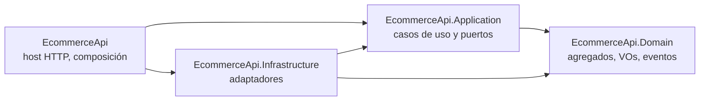

# ADR-0002 — Capas y regla de dependencias verificada con pruebas

> **Estado:** Aceptada · 2026-10-22
> **Ámbito:** organización interna del despliegue HTTP `EcommerceApi`.
> **Complementa a:** [ADR-0001](0001-monolito-modular-vs-microservicios.md).
> **Evidencia:** [`tests/EcommerceApi.Architecture.Tests`](../../tests/EcommerceApi.Architecture.Tests/LayerDependencyTests.cs).

## 1. Contexto

Antes de esta decisión, `EcommerceApi` era un único proyecto: los controladores
dependían de una clase concreta (`InMemoryStore`), los modelos eran anémicos y las
reglas de negocio vivían mezcladas con el transporte HTTP. Eso impide cambiar el
almacenamiento sin tocar los controladores y hace imposible probar las reglas sin
levantar la API.

El objetivo es que el **dominio no sepa cómo se persiste ni cómo se expone**, y que
esa separación no dependa de la disciplina de quien edita el código.

## 2. Decisión

Cuatro proyectos con una única dirección de dependencias:

| Proyecto | Puede depender de | Contiene |
|---|---|---|
| `EcommerceApi.Domain` | nada (solo BCL) | `Order`, `OrderLine`, `Money`, `Product`, eventos de dominio, `DomainException` |
| `EcommerceApi.Application` | `Domain` | comandos, queries, handlers, DTOs de lectura y puertos (`IOrderRepository`, `IProductRepository`) |
| `EcommerceApi.Infrastructure` | `Application`, `Domain` | adaptadores en memoria (y en el futuro persistencia/outbox) |
| `EcommerceApi` (host) | `Application`, `Infrastructure` | controladores, autenticación, CORS, rate limiting y **composition root** |

Reglas adicionales:

- Los controladores solo conocen handlers de `Application`, nunca tipos de
  `Infrastructure`.
- Los agregados no exponen `set` públicos: el estado se cambia con métodos que
  validan invariantes.
- El dominio no usa `DataAnnotations`: la validación de entrada es un asunto del
  transporte, no del modelo.
- No se introducen `MediatR`, `AutoMapper` ni un contenedor adicional para algo que
  se resuelve con interfaces explícitas y el contenedor de ASP.NET Core.

## 3. Verificación automática

La regla no se documenta y se olvida: se comprueba en cada ejecución de pruebas.

| Prueba | Qué impide |
|---|---|
| `Domain_DoesNotReferenceAnyOtherProject` | Que el dominio importe aplicación, infraestructura o el host |
| `Domain_DoesNotReferenceAspNetCore` | Que el dominio se acople a HTTP |
| `Domain_DoesNotUseDataAnnotations` | Que la validación de transporte se cuele en el modelo |
| `Application_DoesNotReferenceInfrastructureOrHost` | Que un caso de uso instancie adaptadores |
| `Infrastructure_DoesNotReferenceTheHost` | Dependencias circulares |
| `Controllers_DoNotDependOnInfrastructure` | Que un controlador use un repositorio concreto |
| `Aggregates_DoNotExposePublicSetters` | Modelos anémicos mutables desde fuera |

## 4. Alternativas consideradas

| Opción | Motivo para descartarla |
|---|---|
| Un solo proyecto con carpetas | La frontera es una convención: nada impide el `using` que la rompe |
| Plantilla "Clean Architecture" con cinco proyectos y MediatR | Ceremonia y dependencias para cinco endpoints; el valor está en la regla, no en el número de carpetas |
| Vertical slices por caso de uso | Atractivo, pero el objetivo del repo es demostrar capas y DDD táctico de forma legible |
| Microservicios por capa | Antipatrón: distribuye el coste sin aislar nada |

## 5. Consecuencias

### Positivas

- Cambiar el almacenamiento afecta a un solo proyecto (`Infrastructure`).
- Las reglas de negocio se prueban en milisegundos, sin host ni base de datos.
- La compilación y las pruebas de arquitectura detectan la erosión a tiempo.

### Negativas y límites

- Más proyectos y `using` que un CRUD de un solo archivo.
- Para un dominio de dos agregados, la separación es deliberadamente
  desproporcionada: aquí se justifica por el objetivo docente y de portfolio.
- Las pruebas de arquitectura validan referencias de ensamblado, no la semántica:
  un `using` dentro del mismo ensamblado no se detecta por capas si algún día se
  fusionan proyectos.

## 6. Cuándo revisar esta decisión

- Si el número de agregados crece y aparece un contexto acotado distinto: valorar
  separar en módulos o extraer un servicio (ADR-0001).
- Si los handlers empiezan a necesitar comportamiento transversal (validación,
  transacciones, eventos): valorar un pipeline explícito antes que un framework.
- Si el equipo crece: revisar la ceremonia frente a la velocidad de entrega.
