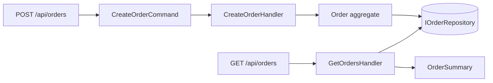

# ADR-0003 — CQRS ligero aplicado solo a pedidos

> **Estado:** Aceptada · 2026-10-22
> **Ámbito:** casos de uso de `EcommerceApi`.
> **Evidencia:** [`EcommerceApi.Application/Orders`](../../EcommerceApi.Application/Orders) y [`tests/EcommerceApi.UnitTests/Application`](../../tests/EcommerceApi.UnitTests/Application).
> **Relacionada con:** [ADR-0002](0002-capas-y-regla-de-dependencias.md).

## 1. Contexto

Pedidos y productos no se parecen:

- **Pedidos** son transaccionales: validan un agregado, capturan el precio en el
  momento de la compra, calculan un total y pertenecen a un usuario. La escritura
  necesita invariantes; la lectura necesita una proyección plana y segura.
- **Productos** son un catálogo CRUD: lo que se lee es prácticamente lo que se
  escribe. Separar modelos ahí solo añade mapeo.

Aplicar CQRS "a todo" porque suena bien es el mismo error que aplicar microservicios
por moda (ADR-0001).

## 2. Decisión

**CQRS ligero solo en pedidos.** Sin event sourcing, sin base de datos de lectura
separada y sin bus de mensajes en esta fase.

| Lado | Tipo | Entrada / salida |
|---|---|---|
| Escritura | `CreateOrderCommand` → `CreateOrderHandler` | Identidad del token + ids de producto → `CreateOrderResult` |
| Lectura | `GetOrdersHandler` / `GetOrderByIdHandler` | Identidad del token (+ id) → `OrderSummary` |
| Modelo de escritura | Agregado `Order` | Invariantes, líneas con precio capturado, `OrderPlacedDomainEvent` |
| Modelo de lectura | `OrderSummary` | `Id`, `CreatedAt`, `ProductIds`, `Total` |

Decisiones concretas:

- **Los fallos esperados son valores, no excepciones.** `CreateOrderResult`
  distingue producto inexistente de entrada inválida; el controlador los mapea a
  `400` sin `try/catch`.
- **El cliente no envía precios.** El handler toma el precio del catálogo en el
  momento de crear el pedido; el total lo calcula el agregado.
- **La autorización por objeto vive en el puerto.** `IOrderRepository.Find(id,
  userId)` no puede devolver un pedido ajeno, así que ningún handler puede filtrar
  mal por descuido.
- **`OrderSummary` no expone `UserId`**: el identificador interno no viaja al
  cliente.
- **`Product` no se convierte en un agregado con CQRS.** Sería ceremonia sin
  beneficio.

### Lo que este diseño NO es

- No es event sourcing: no hay historial de eventos como fuente de verdad.
- No es CQRS con almacenes separados: lectura y escritura comparten repositorio.
- No es una arquitectura distribuida: todo ocurre en proceso.

Llamarlo "CQRS ligero" no es una excusa: es la descripción exacta de lo que hay.

## 3. Alternativas consideradas

| Opción | Motivo para descartarla |
|---|---|
| CRUD único con el agregado serializado | Expone el modelo interno y mezcla invariantes con transporte |
| CQRS con MediatR y pipeline de behaviors | Dependencia y magia para tres handlers |
| CQRS en productos también | Los modelos no divergen; solo añade mapeo |
| Event sourcing desde el inicio | Requiere persistencia de eventos, versionado y proyecciones; no hay caso que lo justifique |

## 4. Consecuencias

### Positivas

- La escritura protege invariantes y la lectura devuelve una proyección segura.
- Los handlers se prueban sin HTTP y sin base de datos.
- El contrato HTTP se mantiene estable (`id`, `productIds`, `total`, `createdAt`).

### Negativas y límites

- Dos caminos para pedidos: más código que un CRUD.
- La lectura comparte almacén con la escritura, así que no hay escalado
  independiente ni consistencia eventual.
- Si más adelante se añade un read model desnormalizado, habrá que decidir cómo se
  actualiza (proyección síncrona o consumidor de eventos).

## 5. Cuándo revisar esta decisión

- Cuando la lectura necesite un almacén distinto, paginación compleja o agregados
  entre pedidos y productos.
- Cuando exista un consumidor externo del evento `OrderPlaced` (fase de outbox):
  ahí la proyección podrá alimentarse de eventos en lugar del repositorio.
- Si el catálogo empieza a tener reglas de negocio (reservas de stock, precios por
  cliente), replantear si sigue siendo CRUD simple.
