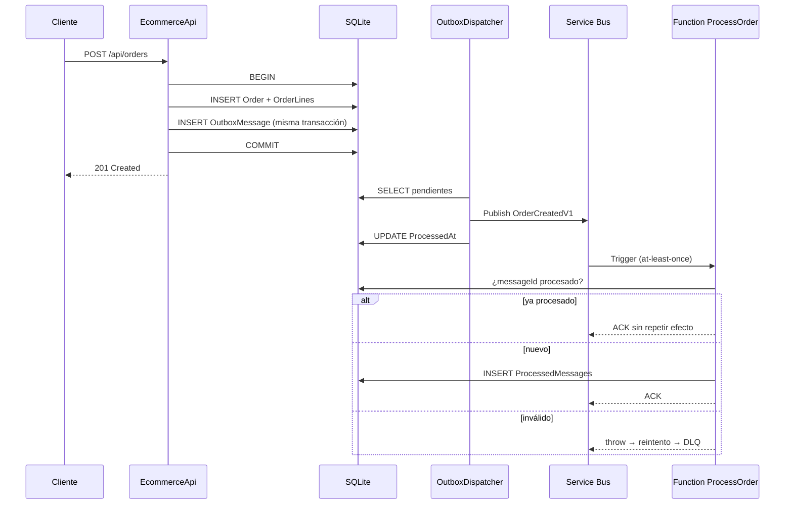

# ADR-0004 — Persistencia SQLite y outbox transaccional

> **Estado:** Aceptada · 2026-10-22
> **Ámbito:** persistencia del workload, publicación de eventos y consumidor asíncrono.
> **Complementa a:** [ADR-0001](0001-monolito-modular-vs-microservicios.md), [ADR-0003](0003-cqrs-ligero-en-pedidos.md).
> **Evidencia:** [`tests/EcommerceApi.Infrastructure.Tests`](../../tests/EcommerceApi.Infrastructure.Tests) y [`tests/EcommerceApi.UnitTests/Application/ProcessOrderHandlerTests.cs`](../../tests/EcommerceApi.UnitTests/Application/ProcessOrderHandlerTests.cs).

## 1. Contexto

Con el almacén en memoria no se puede demostrar el patrón outbox: si el proceso cae entre la escritura del pedido y la publicación del evento, no hay nada que recuperar. Tampoco hay transacción que abarque ambas operaciones.

El diseño de [`docs/functions.md`](../functions.md) ya exigía una publicación fiable de `OrderCreated`, idempotencia en el consumidor y dead-letter. Para que eso sea verificable y no una maqueta, hace falta persistencia real.

## 2. Decisión

1. **SQLite** como almacén del laboratorio, mediante `Microsoft.Data.Sqlite` y SQL explícito. Sin ORM.
2. **Importes en céntimos enteros** (`INTEGER`). SQLite no tiene `DECIMAL` y `REAL` perdería precisión en totales.
3. **Outbox transaccional**: el pedido y su mensaje se escriben en la misma transacción (`Orders`, `OrderLines`, `OutboxMessages`).
4. **Despachador en background** (`OutboxDispatcher`) que publica pendientes cada 2 segundos, con contador de intentos y *dead-letter* tras 5 fallos.
5. **Contrato versionado** `OrderCreatedV1` en `EcommerceApi.Contracts`, compartido por productor y consumidor. `MessageId = "<orderId>:v1"`.
6. **Consumidor idempotente**: la Function delega en `ProcessOrderHandler`, que valida el mensaje y consulta `ProcessedMessages` por `messageId` antes de registrar el efecto.
7. **Publicador conmutable**:
   - `Publisher:Mode=Log` (por defecto): registra el mensaje en el log local.
   - `Publisher:Mode=ServiceBus`: publica en Azure Service Bus (requiere conexión real; no se ejecuta en este laboratorio).

## 3. Garantías y lo que no garantiza

| Garantía | Estado |
|---|---|
| El pedido y su evento se confirman juntos o no se confirman | **Implementado y probado** |
| Un fallo de publicación no pierde el evento | **Implementado y probado** (queda pendiente en la tabla) |
| Reintentos acotados y dead-letter | **Implementado y probado** (5 intentos) |
| Entrega al menos una vez | **Implementado** (contrato de Service Bus) |
| Idempotencia del consumidor | **Implementado y probado** |
| Entrega exactamente una vez | **No existe**; se resuelve con idempotencia |
| Publicación real en Service Bus | **Diseño**: sin namespace desplegado |
| Function desplegada en Azure | **Diseño**: proyecto compila, no se ha desplegado |

## 4. Alternativas consideradas

| Opción | Motivo para descartarla |
|---|---|
| Outbox en memoria | No sobrevive a un reinicio; no demuestra la garantía |
| EF Core | Más dependencias y magia para cinco tablas; el SQL explícito enseña la transacción |
| Event sourcing | No hay requisito de historial como fuente de verdad |
| Publicar el evento dentro de la petición HTTP | Acopla la latencia y el fallo del broker a la respuesta al cliente |
| Broker embebido (RabbitMQ/Kafka local) | Añade operación pesada para un laboratorio; Service Bus es el objetivo declarado |

## 5. Consecuencias

### Positivas

- La consistencia entre escritura y publicación es verificable con pruebas.
- El consumidor tolera duplicados y mensajes corruptos sin perderlos.
- El contrato vive en un proyecto compartido: productor y consumidor no se desincronizan.

### Negativas y límites

- SQLite es de un solo escritor y no sirve para producción con concurrencia real.
- En Azure, la Function **no comparte** el fichero SQLite de la API: el adaptador de idempotencia debe ser Table Storage o SQL. El contrato `IProcessedMessageStore` permite ese cambio sin tocar el caso de uso.
- El despachador es *at-least-once*: la ventana entre publicar y marcar como procesado puede duplicar un mensaje. El consumidor lo absorbe.
- No hay migraciones versionadas: el esquema se crea con `CREATE TABLE IF NOT EXISTS`. Un cambio de esquema exigirá una estrategia de migración.
- El cifrado en reposo y la copia de seguridad no están resueltos.

## 6. Cuándo revisar esta decisión

- Antes de cualquier despliegue con más de un escritor: migrar a SQL Server o PostgreSQL.
- Si aparece un segundo consumidor: pasar de cola a tema y revisar el contrato.
- Si el volumen de outbox crece: añadir purga de mensajes procesados y métricas de antigüedad.
- Si se necesita trazabilidad regulatoria: valorar log append-only o event store, no reutilizar el outbox.

## 7. Referencias

- Chris Richardson, *Transactional Outbox* y *Idempotent Consumer*.
- [`docs/functions.md`](../functions.md): hosting, reintentos y dead-letter.
- [`docs/adr/0001`](0001-monolito-modular-vs-microservicios.md): por qué un segundo despliegue y no microservicios.
