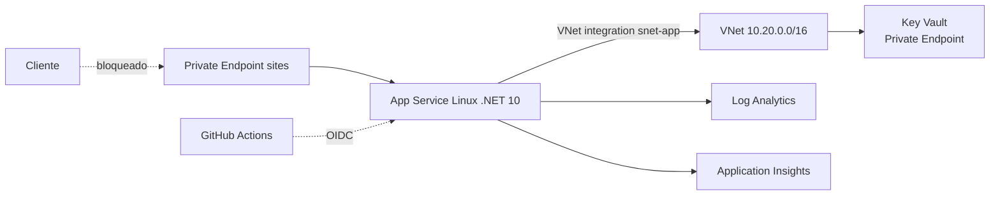

# App Service — diseño de la plataforma de ejecución

> **Estado:** Diseño. La plantilla existe y se valida estáticamente, pero **no se ha desplegado**.
> **Ámbito:** plataforma de ejecución de `EcommerceApi`. No sustituye a `infra/README.md` ni al Bicep.
> **Última revisión:** 2026-10-22.
> **Sesión asociada:** T2 (estudio y preguntas) → T3 (IaC) → T4 (despliegue) → T5 (slots).

> **En fácil:** este documento es el plano de cómo se ejecutaría la API en Azure: qué piezas hay, qué hace cada una y qué falta antes de desplegar. Todavía no se ha desplegado nada.

## 1. Para qué sirve este documento

Explicar cómo se ejecuta la API en Azure, qué decisiones hay detrás y qué se debe comprobar antes de desplegar. No es un tutorial: es el plano que se estudia en T2 y que se corrige si algo no cuadra.

Incluye una separación explícita entre Bicep, el pipeline YAML y el artefacto (§3) y un desglose de qué define exactamente la plantilla (§4), porque es la confusión más habitual al leer `infra/main.bicep`.

## 2. Modelo de ejecución

| Pieza | Qué es | Qué decide |
|---|---|---|
| **App Service Plan** | La máquina (CPU/RAM) y la SKU | Cuánto cuesta, qué características hay disponibles y cómo escala |
| **App Service (site)** | La aplicación concreta | Runtime, configuración, identidad, red, slots |
| **Slot** | Una instancia paralela del site | Desplegar y calentar antes de publicar |
| **Deployment** | El artefacto (zip o contenedor) | Cómo llega el código |

Idea clave: **el plan se paga siempre; el site no cuesta aparte**. Varios sites pueden compartir un plan, pero comparten CPU y se afectan entre sí.

## 3. Bicep no es el pipeline: tres capas que conviene separar

Una confusión habitual es llamar «YAML de infraestructura» a todo. En realidad hay tres capas distintas que se complementan:

| Capa | Pregunta que responde | Herramienta | En este repositorio |
|---|---|---|---|
| **Infraestructura** (estado deseado) | ¿Qué recursos deben existir y cómo están configurados? | **Bicep** | `infra/main.bicep` |
| **Orquestación** (pasos) | ¿Qué se ejecuta en cada push o PR? | **YAML** de GitHub Actions | `.github/workflows/devsecops-ci.yml` |
| **Artefacto** (lo que corre) | ¿Qué binario o imagen se publica en ese App Service? | `dotnet publish` / Docker | `publish` y `Dockerfile` |

Regla mental:

- **Bicep** es el **plano del edificio**: dice qué paredes, puertas y conexiones debe haber.
- **El YAML** es la **orden de trabajo**: dice cuándo se revisa el plano, cuándo se construye y qué comprobaciones se hacen.
- **El artefacto** es lo que se **instala dentro**: el código publicado o la imagen del contenedor.

Por eso Bicep **no** hace ninguna de estas cosas:

- No compila ni ejecuta pruebas.
- No sube el código de la API.
- No arranca la aplicación ni reinicia el proceso.
- No crea la base de datos lógica ni ejecuta migraciones.
- No decide el contenido de `appsettings.json` (solo inyecta variables de entorno).

El flujo completo es:

```text
push / PR
   │
   ├── YAML: dotnet restore · build · test · Trivy · CodeQL · Gitleaks
   │
   ├── YAML: bicep build infra/main.bicep  →  ARM JSON
   │            └── Trivy config (validación estática, sin desplegar)
   │
   └── (T4, autorizado) az deployment group what-if / create
                │
                └── existen el plan y el site con su configuración
                          │
                          └── (aparte) zip deploy o pull de la imagen
```

### Qué es Bicep exactamente

Bicep es un **DSL de Microsoft, exclusivo de Azure**, que se compila a **plantillas ARM (JSON)**. No es un lenguaje de propósito general ni un sustituto del pipeline.

| Propiedad | Consecuencia práctica |
|---|---|
| **Declarativo** | No describes pasos, describes el estado final. Si el recurso ya coincide, no se recrea (idempotente) |
| **Dependencias implícitas** | Si un recurso usa `appServicePlan.id`, Bicep deduce que el plan debe existir antes; no hay que ordenar pasos a mano |
| **Tipado y validación** | `param tenantId string` y `@minLength(3)` fallan en compilación, no a mitad del despliegue |
| **Compilable** | `bicep build infra/main.bicep` genera ARM JSON y detecta errores sin tocar Azure |
| **Modular** | Se puede dividir en `modules/network.bicep`, `modules/app.bicep`; hoy el repo usa un único fichero |
| **`what-if`** | `az deployment group what-if` muestra qué cambiaría antes de aplicar |
| **`existing`** | Permite referenciar un recurso ya definido y obtener su `id` sin duplicar la declaración. El repo lo usa para las subredes declaradas dentro de la VNet |

Bicep es solo Azure. Si el laboratorio necesitara AWS o GCP, el equivalente sería Terraform o Pulumi; no tiene sentido mezclarlos solo por moda.

## 4. Qué define exactamente el Bicep de este repositorio

No define «un App Service» aislado: define todo el grupo de recursos y las relaciones entre sus piezas.

### 4.1. Recursos declarados

| Bloque | Recurso de Azure | Para qué |
|---|---|---|
| Red | VNet `10.20.0.0/16`, `snet-app`, `snet-pe`, NSG | Aislar entrada y salida |
| Observabilidad | Log Analytics + Application Insights | Logs, métricas y trazas |
| Secretos | Key Vault + Private Endpoint + DNS privado | Guardar secretos sin exponerlos |
| Cómputo | **App Service Plan** Linux `P1v3` | Capacidad y coste |
| Aplicación | **App Service (site)** Linux .NET 10 | Runtime, settings, identidad y red |
| Entrada | Private Endpoint del site + DNS privado | Que la API no tenga IP pública |
| Salida | VNet Integration en `snet-app` + `vnetRouteAllEnabled` | Que la API resuelva y salga por la VNet |
| Permisos | Rol *Key Vault Secrets User* para la identidad | Leer secretos sin credenciales |

### 4.2. Plan y site: no son lo mismo

```bicep
// 1) El cómputo: familia, SKU e instancias
resource appServicePlan 'Microsoft.Web/serverfarms@2023-12-01' = {
  name: appServicePlanName
  kind: 'linux'
  sku: {
    name: 'P1v3'
    tier: 'PremiumV3'
    capacity: 1
  }
  properties: {
    reserved: true
  }
}

// 2) La aplicación que corre encima
resource apiApp 'Microsoft.Web/sites@2023-12-01' = {
  name: appName
  identity: { type: 'SystemAssigned' }
  properties: {
    serverFarmId: appServicePlan.id
    httpsOnly: true
    publicNetworkAccess: 'Disabled'
    virtualNetworkSubnetId: appSubnet.id
    siteConfig: {
      linuxFxVersion: 'DOTNETCORE|10.0'
      minTlsVersion: '1.2'
      ftpsState: 'Disabled'
      alwaysOn: true
      vnetRouteAllEnabled: true
      appSettings: [ /* ... */ ]
    }
  }
}
```

| Pieza | Recurso | Qué decides | Dónde está el CPU/RAM |
|---|---|---|---|
| **Plan** | `Microsoft.Web/serverfarms` | Familia, SKU, número de instancias, sistema operativo | Implícito en el SKU |
| **Site** | `Microsoft.Web/sites` | Runtime, variables, identidad, TLS, red, slots | No se declara aquí |

**No se pone «2 vCPU y 8 GB» como número.** Se elige un SKU y Azure deriva la capacidad:

| SKU | vCPU aproximadas | RAM aproximada | Uso típico |
|---|---|---|---|
| `B1` | 1 | 1,75 GB | Laboratorio barato, sin slots |
| `S1` | 1 | 1,75 GB | Slots y autoscale |
| `P1v3` | 2 | 8 GB | Diseño actual con red privada |
| `P2v3` | 4 | 16 GB | Más carga |
| `P3v3` | 8 | 32 GB | Carga alta |

> Los valores exactos dependen de la región y de la tabla oficial de SKUs; confírmalos antes de T4. `capacity: 1` significa **una instancia**, no «un núcleo».

Escalar tiene dos direcciones:

- **Scale up**: cambiar de SKU (`P1v3` → `P2v3`) para más CPU/RAM.
- **Scale out**: subir `capacity` o configurar autoscale para más instancias.

### 4.3. El site no es un contenedor por defecto

Esta es la diferencia que más se presta a confusión en este repo, porque existe un `Dockerfile`:

```bicep
siteConfig: {
  linuxFxVersion: 'DOTNETCORE|10.0'
}
```

Eso significa **despliegue de código**: App Service publica y ejecuta tu build de .NET en su propio sandbox. **No** está ejecutando la imagen del `Dockerfile`.

Para usar la imagen haría falta algo así:

```bicep
siteConfig: {
  linuxFxVersion: 'DOCKER|miregistro.azurecr.io/ecommerce-api:1.0.0'
}
// más identidad con AcrPull, o credenciales del registro
```

Hoy el `Dockerfile` se usa para:

- Ejecución local reproducible.
- Trivy image y verificación de usuario no-root en CI.
- Documentar el endurecimiento del contenedor.

Pero **no llega a Azure**. El Bicep define código, no contenedor.

#### Decisión pendiente: código o contenedor

| Criterio | Zip deploy (código) | Contenedor (ACR) |
|---|---|---|
| Paridad con local | Baja: local usa Docker, Azure usa publish | Alta: la misma imagen en ambos |
| Complejidad | Baja: sin registro ni pull | Media: ACR, rol `AcrPull`, tags |
| Escaneo de seguridad | Trivy sobre el `Dockerfile` | Trivy sobre la imagen que realmente se despliega |
| Arranque | Más rápido | Pull + arranque del contenedor |
| Coherencia con el portfolio | Menor | Mayor si el discurso es «contenedor endurecido» |

**Estado actual:** el diseño es **zip deploy** y el Bicep lo refleja. La decisión no está cerrada; si se elige contenedor, hay que cambiar `linuxFxVersion`, añadir el registro y actualizar este documento y el pipeline. No se debe afirmar que el contenedor está desplegado.

### 4.4. Qué NO define el Bicep

| Elemento | Dónde se resuelve |
|---|---|
| Código o imagen publicada | `dotnet publish` / `docker push` + despliegue |
| Slot `staging` y swap | No está en la plantilla; se diseña en T5 |
| Autoscale | No está en la plantilla; se decide en T3/T4 |
| Base de datos SQLite | Fichero local del laboratorio; no es un recurso de Azure |
| Secretos reales | Key Vault; el Bicep solo asigna el rol |
| Certificado y dominio personalizado | Fuera del alcance actual |

### 4.5. Cómo leer el fichero sin perderte

1. `targetScope`: el despliegue es a nivel de **grupo de recursos**.
2. `param`: lo que cambia por entorno (tenant, client, audience, prefijo, retención).
3. `var`: nombres derivados y `uniqueString` para evitar colisiones.
4. Recursos de red y observabilidad.
5. Plan y site: el núcleo de este documento.
6. Private Endpoints, DNS y asignación de rol: las relaciones que hacen que la red privada funcione.
7. Diagnóstico: qué logs se envían y a dónde.

## 5. Arquitectura actual (IaC)



Recursos ya definidos en `infra/main.bicep`:

- Plan Linux `P1v3`, `reserved: true`.
- Site Linux con `linuxFxVersion: DOTNETCORE|10.0`, HTTPS only, TLS 1.2, FTPS off, HTTP/2, `alwaysOn`.
- Identidad gestionada asignada por el sistema.
- Integración VNet en `snet-app` (delegada a `Microsoft.Web/serverFarms`) y `vnetRouteAllEnabled`.
- Acceso público deshabilitado y Private Endpoint en `snet-pe` con DNS privado.
- Key Vault con RBAC, sin acceso público, y rol *Key Vault Secrets User* para la identidad.
- Diagnóstico a Log Analytics y Application Insights.

## 6. La confusión que hay que resolver en T2

**Entrada y salida son cosas distintas:**

| Dirección | Mecanismo | Para qué |
|---|---|---|
| **Entrada** (alguien llama a la API) | Private Endpoint + DNS privado | Que la API no tenga exposición a Internet |
| **Salida** (la API llama a Key Vault, Storage…) | VNet Integration regional | Que el tráfico salga por la VNet y resuelva por DNS privado |

Un Private Endpoint **no** da salida a la VNet. Una VNet Integration **no** bloquea la entrada pública. Se necesitan las dos, y por eso el Bicep tiene dos subredes.

**Consecuencia práctica:** con `publicNetworkAccess: 'Disabled'`, desde tu portátil **no vas a llegar** a la API ni al SCM. Antes de T4 hay que elegir modelo de acceso:

- **A. VPN punto a sitio** o máquina dentro de la VNet (lo más fiel).
- **B. Acceso público temporal restringido a tu IP** durante el laboratorio, y volver a cerrarlo después (lo más barato).
- **C. Solo desde GitHub Actions**, sin acceso interactivo (lo más seguro, pero difícil de depurar).

Decisión provisional: **B para T4**, documentando la apertura y el cierre en la evidencia. A para T5 si se quiere probar el swap con tráfico real.

## 7. Identidad y configuración

- La identidad gestionada elimina secretos de la aplicación: no hay client secret en el código ni en app settings.
- Los secretos reales (si algún día hay) se referencian con **Key Vault references**:
  `@Microsoft.KeyVault(VaultName=<kv>;SecretName=<nombre>)`, sin versión fija.
- Los identificadores de Entra ID (`TenantId`, `ClientId`, `Audience`) **no son secretos**: son configuración y pueden ir en app settings.
- `APPLICATIONINSIGHTS_CONNECTION_STRING` contiene una clave de ingesta: trátala como secreto y muévela a Key Vault reference en T3.
- Límite a recordar: App Service tiene un máximo de referencias a Key Vault por aplicación; no conviene convertir toda la configuración en referencia.

## 8. Despliegue y slots

- **Artefacto:** zip deploy del publish de .NET (`dotnet publish`) o imagen de contenedor. **Decisión provisional: zip** (ver §4.3); si se elige contenedor hay que cambiar `linuxFxVersion` y añadir el registro.
- **Autenticación del pipeline:** OIDC federado con `azure/login@v2` y `permissions: id-token: write`. Sin secretos de larga duración. Ya está documentado en `infra/README.md` como diseño.
- **Slots:** `staging` → swap a `production`. Permiten calentar y volver atrás. **Exigen Standard o superior**; con B1 no hay slots.
- **Warm-up:** `applicationInitialization` o `WEBSITE_SWAP_WARMUP_PING_PATH` apuntando a `/health`.
- **Rollback:** swap inverso del slot, no redeploy.

## 9. Observabilidad

- Diagnóstico ya definido: `AppServiceHTTPLogs`, `AppServiceConsoleLogs`, `AppServiceAppLogs`, `AppServiceAuditLogs`, `AppServicePlatformLogs`.
- Application Insights para trazas y dependencias.
- Consultas de referencia:

```kusto
// Peticiones por código de estado en la última hora
AppServiceHTTPLogs
| where TimeGenerated > ago(1h)
| summarize peticiones = count() by ScStatus, CsUriStem
| order by peticiones desc

// Errores 5xx con su ruta
AppServiceHTTPLogs
| where TimeGenerated > ago(24h) and ScStatus startswith "5"
| project TimeGenerated, CsUriStem, ScStatus, TimeTaken, CsHost
```

## 10. Escalado y coste

- El escalado automático exige **Standard o superior**; en B1 se escala a mano (o no se escala).
- Regla de laboratorio: 1 instancia, sin autoscale. El autoscale se **diseña** en T3 y se **prueba** solo si hay presupuesto.

| SKU | Uso | Coste aproximado |
|---|---|---|
| **B1** Linux | Primer despliegue, sin slots | ~12–15 €/mes |
| **S1** Linux | Slots y autoscale | ~70 €/mes |
| **P1v3** Linux | Diseño actual (red privada completa) | ~130–150 €/mes |

> Precios orientativos; confirma en la calculadora de Azure antes de T4. Un laboratorio de una tarde con B1 cuesta céntimos si se destruye el mismo día.

## 11. Decisiones (ADR corto)

| Decisión | Alternativa descartada | Motivo |
|---|---|---|
| App Service Linux | Container Apps, AKS | Es el modelo más simple que demuestra PaaS, slots y red privada sin clúster |
| Zip deploy (**provisional**) | Contenedor en ACR | Menos piezas para el primer despliegue; la decisión y su coste están en §4.3 |
| Identidad gestionada + Key Vault | Secretos en app settings | Elimina credenciales; encaja con el discurso de seguridad |
| SKU parametrizada | P1v3 fija | El coste del laboratorio no debe impedir ejecutarlo |

## 12. Plan de validación (T4)

Pruebas positivas:

1. `GET /health` responde 200 desde dentro de la VNet.
2. `GET /api/products` con token válido responde 200.
3. El DNS privado resuelve el site a una IP de `snet-pe`.
4. Los logs aparecen en Log Analytics en menos de 5 minutos.

Pruebas negativas:

1. Sin token → 401.
2. Desde Internet, el site no responde (o responde 403).
3. Acceso al SCM bloqueado por la misma regla.
4. Token de otro tenant → 401.

Cada prueba se registra en la evidencia con comando, salida redactada y resultado.

## 13. Preguntas abiertas para T2

1. ¿Qué características pierdes exactamente al bajar de P1v3 a B1?
2. ¿Por qué la subred de integración necesita delegación y la de Private Endpoint no?
3. ¿Qué hace `vnetRouteAllEnabled` y qué pasaría si estuviera en `false`?
4. ¿Dónde vive el DNS privado y quién lo consulta?
5. ¿Por qué el SCM también hay que protegerlo?
6. ¿Qué cambia en el Bicep si se elige contenedor en lugar de zip, y qué rol necesita la identidad para hacer pull del ACR?

## 14. Limitaciones

- No hay base de datos gestionada ni alta disponibilidad: la API usa SQLite local, que en App Service no es almacenamiento duradero ni compartido entre instancias.
- El diseño no cubre WAF ni API Management; eso es T9.
- La SKU y el coste deben confirmarse antes de desplegar.
- La decisión **código vs contenedor** sigue abierta (§4.3); el Bicep actual refleja zip deploy.
- Nada de este documento está validado en Azure todavía.
