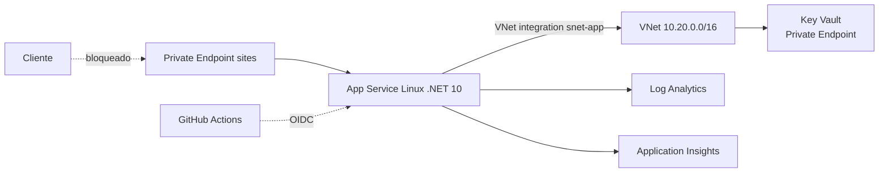

# App Service — diseño de la plataforma de ejecución

> **Estado:** Diseño. La plantilla existe y se valida estáticamente, pero **no se ha desplegado**.
> **Ámbito:** plataforma de ejecución de `EcommerceApi`. No sustituye a `infra/README.md` ni al Bicep.
> **Última revisión:** 2026-10-21.
> **Sesión asociada:** T2 (estudio y preguntas) → T3 (IaC) → T4 (despliegue) → T5 (slots).

## 1. Para qué sirve este documento

Explicar **cómo se ejecuta la API en Azure**, qué decisiones hay detrás y qué se debe comprobar antes de desplegar. No es un tutorial: es el plano que se estudia en T2 y que se corrige si algo no cuadra.

## 2. Modelo de ejecución

| Pieza | Qué es | Qué decide |
|---|---|---|
| **App Service Plan** | La máquina (CPU/RAM) y la SKU | Cuánto cuesta, qué características hay disponibles y cómo escala |
| **App Service (site)** | La aplicación concreta | Runtime, configuración, identidad, red, slots |
| **Slot** | Una instancia paralela del site | Desplegar y calentar antes de publicar |
| **Deployment** | El artefacto (zip o contenedor) | Cómo llega el código |

Idea clave: **el plan se paga siempre; el site no cuesta aparte**. Varios sites pueden compartir un plan, pero comparten CPU y se afectan entre sí.

## 3. Arquitectura actual (IaC)



Recursos ya definidos en `infra/main.bicep`:

- Plan Linux `P1v3`, `reserved: true`.
- Site Linux con `linuxFxVersion: DOTNETCORE|10.0`, HTTPS only, TLS 1.2, FTPS off, HTTP/2, `alwaysOn`.
- Identidad gestionada asignada por el sistema.
- Integración VNet en `snet-app` (delegada a `Microsoft.Web/serverFarms`) y `vnetRouteAllEnabled`.
- Acceso público deshabilitado y Private Endpoint en `snet-pe` con DNS privado.
- Key Vault con RBAC, sin acceso público, y rol *Key Vault Secrets User* para la identidad.
- Diagnóstico a Log Analytics y Application Insights.

## 4. La confusión que hay que resolver en T2

**Entrada y salida son cosas distintas:**

| Dirección | Mecanismo | Para qué |
|---|---|---|
| **Entrada** (alguien llama a la API) | Private Endpoint + DNS privado | Que la API no tenga exposición a Internet |
| **Salida** (la API llama a Key Vault, Storage…) | VNet Integration regional | Que el tráfico salga por la VNet y resuelva por DNS privado |

Un Private Endpoint **no** da salida a la VNet. Una VNet Integration **no** bloquea la entrada pública. Se necesitan las dos, y por eso el Bicep tiene dos subredes.

**Consecuencia práctica:** con `publicNetworkAccess: 'Disabled'`, desde tu portátil **no vas a llegar** a la API ni al SCM. Antes de T4 hay que elegir modelo de acceso:

- **A. VPN punto a sitio** o máquina dentro de la VNet (lo más fiel).
- **B. Acceso público temporal restringido a tu IP** durante el laboratorio, y volver a cerrarlo después (lo más barato).
- **C. Solo desde GitHub Actions**, sin acceso interactivo (lo más seguro, pero difícil de depurar).

Decisión provisional: **B para T4**, documentando la apertura y el cierre en la evidencia. A para T5 si se quiere probar el swap con tráfico real.

## 5. Identidad y configuración

- La identidad gestionada elimina secretos de la aplicación: no hay client secret en el código ni en app settings.
- Los secretos reales (si algún día hay) se referencian con **Key Vault references**:
  `@Microsoft.KeyVault(VaultName=<kv>;SecretName=<nombre>)`, sin versión fija.
- Los identificadores de Entra ID (`TenantId`, `ClientId`, `Audience`) **no son secretos**: son configuración y pueden ir en app settings.
- `APPLICATIONINSIGHTS_CONNECTION_STRING` contiene una clave de ingesta: trátala como secreto y muévela a Key Vault reference en T3.
- Límite a recordar: App Service tiene un máximo de referencias a Key Vault por aplicación; no conviene convertir toda la configuración en referencia.

## 6. Despliegue y slots

- **Artefacto:** zip deploy del publish de .NET (`dotnet publish`), o imagen de contenedor. Para el laboratorio, zip: más simple y sin registro.
- **Autenticación del pipeline:** OIDC federado con `azure/login@v2` y `permissions: id-token: write`. Sin secretos de larga duración. Ya está documentado en `infra/README.md` como diseño.
- **Slots:** `staging` → swap a `production`. Permiten calentar y volver atrás. **Exigen Standard o superior**; con B1 no hay slots.
- **Warm-up:** `applicationInitialization` o `WEBSITE_SWAP_WARMUP_PING_PATH` apuntando a `/health`.
- **Rollback:** swap inverso del slot, no redeploy.

## 7. Observabilidad

- Diagnóstico ya definido: `AppServiceHTTPLogs`, `AppServiceConsoleLogs`, `AppServiceAppLogs`, `AppServiceAuditLogs`, `AppServicePlatformLogs`.
- Application Insights para trazas y dependencias.
- Consultas de referencia:

```kusto
// Peticiones por código de estado en la última hora
AppServiceHTTPLogs
| where TimeGenerated > ago(1h)
| summarize peticiones = count() by ScStatus, CsUriStem
| order by peticiones desc

// Errores 5xx con su ruta
AppServiceHTTPLogs
| where TimeGenerated > ago(24h) and ScStatus startswith "5"
| project TimeGenerated, CsUriStem, ScStatus, TimeTaken, CsHost
```

## 8. Escalado y coste

- El escalado automático exige **Standard o superior**; en B1 se escala a mano (o no se escala).
- Regla de laboratorio: 1 instancia, sin autoscale. El autoscale se **diseña** en T3 y se **prueba** solo si hay presupuesto.

| SKU | Uso | Coste aproximado |
|---|---|---|
| **B1** Linux | Primer despliegue, sin slots | ~12–15 €/mes |
| **S1** Linux | Slots y autoscale | ~70 €/mes |
| **P1v3** Linux | Diseño actual (red privada completa) | ~130–150 €/mes |

> Precios orientativos; confirma en la calculadora de Azure antes de T4. Un laboratorio de una tarde con B1 cuesta céntimos si se destruye el mismo día.

## 9. Decisiones (ADR corto)

| Decisión | Alternativa descartada | Motivo |
|---|---|---|
| App Service Linux | Container Apps, AKS | Es el modelo más simple que demuestra PaaS, slots y red privada sin clúster |
| Zip deploy | Contenedor en ACR | Menos piezas; el contenedor ya se demuestra en el pipeline |
| Identidad gestionada + Key Vault | Secretos en app settings | Elimina credenciales; encaja con el discurso de seguridad |
| SKU parametrizada | P1v3 fija | El coste del laboratorio no debe impedir ejecutarlo |

## 10. Plan de validación (T4)

Pruebas positivas:

1. `GET /health` responde 200 desde dentro de la VNet.
2. `GET /api/products` con token válido responde 200.
3. El DNS privado resuelve el site a una IP de `snet-pe`.
4. Los logs aparecen en Log Analytics en menos de 5 minutos.

Pruebas negativas:

1. Sin token → 401.
2. Desde Internet, el site no responde (o responde 403).
3. Acceso al SCM bloqueado por la misma regla.
4. Token de otro tenant → 401.

Cada prueba se registra en la evidencia con comando, salida redactada y resultado.

## 11. Preguntas abiertas para T2

1. ¿Qué características pierdes exactamente al bajar de P1v3 a B1?
2. ¿Por qué la subred de integración necesita delegación y la de Private Endpoint no?
3. ¿Qué hace `vnetRouteAllEnabled` y qué pasaría si estuviera en `false`?
4. ¿Dónde vive el DNS privado y quién lo consulta?
5. ¿Por qué el SCM también hay que protegerlo?

## 12. Limitaciones

- No hay base de datos ni alta disponibilidad: el workload es de laboratorio.
- El diseño no cubre WAF ni API Management; eso es T9.
- La SKU y el coste deben confirmarse antes de desplegar.
- Nada de este documento está validado en Azure todavía.
