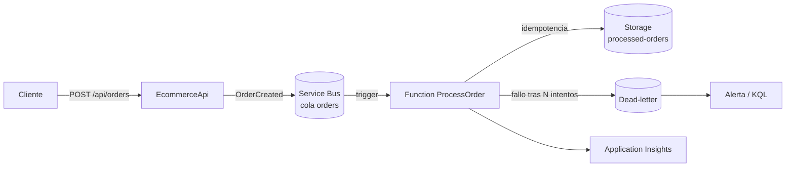

# Azure Functions — diseño del cómputo asíncrono

> **Estado:** Parcial. Proyecto de Function, contrato versionado, outbox transaccional e idempotencia implementados y probados en local. Sin Service Bus real ni despliegue en Azure.
> **Ámbito:** procesamiento asíncrono del workload `EcommerceApi`.
> **Última revisión:** 2026-10-22.
> **Sesión asociada:** T6 (estudio y decisiones) → T7 (implementación local) → T8 (despliegue y observación).

> **En fácil:** la Function es el ayudante que hace el trabajo pesado después de responder al cliente: recibe el pedido, lo procesa y no repite el efecto si el mensaje llega dos veces. Está probada en local; en Azure todavía no está desplegada.

## 1. Para qué sirve este documento

Fijar qué función añadimos, por qué, con qué garantías y cómo se prueba, antes de escribir código. La regla del repositorio es no introducir una pieza nueva sin una decisión escrita.

## 2. El caso de uso

Hoy `POST /api/orders` crea el pedido y responde. Todo lo que ocurre después (confirmar stock, notificar, registrar) tendría que ir dentro de la petición, alargándola y acoplándola.

**Caso elegido:** al crear un pedido, la API publica `OrderCreated` en Service Bus. Una Function `ProcessOrder` lo consume, comprueba el pedido y registra el resultado de forma idempotente. Si algo falla, el mensaje se reintenta y, si se agota, va a la cola de mensajes muertos.



## 3. Por qué una Function y no un `BackgroundService`

| Criterio | Function | BackgroundService en la API |
|---|---|---|
| Escala con la cola | Sí | No: escala con la API |
| Reintentos y dead-letter | Nativos | A mano |
| Coste en reposo | Cero (Flex/Consumption) | Paga la instancia |
| Aislamiento de fallos | Sí | Un fallo puede tumbar la API |
| Complejidad operativa | Media | Baja |

La Function no sustituye a la API: separa el trabajo que no debe bloquear la respuesta.

## 4. Modelo de hosting

| Plan | Escala a cero | VNet integration | Cold start | Uso previsto |
|---|---|---|---|---|
| **Flex Consumption** | Sí | Sí | Bajo | **Recomendado** para el laboratorio |
| Premium | No (mínimo 1) | Sí | Muy bajo | Si se exige latencia estable |
| Consumption clásico | Sí | No | Alto | Solo si no hay red privada |
| Dedicated (App Service) | No | Sí | Ninguno | Si se comparte plan con la API |

Decisión provisional: **Flex Consumption**, porque permite red privada y escala a cero. Se confirma en T6 tras revisar límites y regiones disponibles.

Runtime: **.NET 10 con modelo isolated**. El modelo in-process está retirado; no se usa.

## 5. Contrato del mensaje

```json
{
  "messageId": "<order-id>:v1",
  "orderId": "<guid>",
  "userId": "<oid>",
  "createdAt": "<ISO-8601>",
  "items": [{ "productId": "<guid>", "quantity": 1 }]
}
```

- `messageId` es la clave de idempotencia. Si cambia el formato del mensaje, cambia la versión (`:v2`).
- El mensaje no lleva datos personales ni secretos.
- El producto no se confía: la Function valida cantidades y referencias.

## 6. Garantías y errores

Service Bus entrega al menos una vez. No existe «exactamente una vez» gratis; la idempotencia es responsabilidad del consumidor.

- **Idempotencia:** antes de procesar, se comprueba `messageId` en el almacén. Si ya está, se completa el mensaje sin repetir efectos.
- **Reintentos:** `maxDeliveryCount` configurado (por ejemplo 5). Cada intento queda en el log con el `deliveryCount`.
- **Dead-letter:** al agotar intentos, el mensaje va a la DLQ. Se consulta y se alerta; **no se reprocesa a ciegas**.
- **Mensajes envenenados:** un mensaje que siempre falla no debe bloquear la cola. La DLQ es la válvula.
- **Concurrencia:** `maxConcurrentCalls` limitado para no saturar el almacén.

## 7. Seguridad

- **Sin cadenas de conexión.** Identidad gestionada de la Function con:
  - *Azure Service Bus Data Receiver* sobre la cola.
  - *Storage Table Data Contributor* (o el rol mínimo equivalente) sobre el almacén.
- Service Bus y Storage con **Private Endpoint** y acceso público deshabilitado; la Function con VNet Integration.
- Si se necesita un secreto, Key Vault reference. Nunca `local.settings.json` versionado.
- El mensaje se valida antes de usarlo: no se deserializa a ciegas ni se ejecuta contenido.

## 8. Observabilidad

- Application Insights con trazas distribuidas: la operación del mensaje se correlaciona con la petición que lo originó.
- Log estructurado con `orderId`, `messageId`, `deliveryCount` y resultado.
- KQL de referencia:

```kusto
// Fallos de procesamiento por tipo de excepción
traces
| where timestamp > ago(24h)
| where message has "ProcessOrder" and severityLevel >= 3
| summarize fallos = count() by tostring(customDimensions["exceptionType"])

// Mensajes muertos: consulta a la DLQ (requiere métrica o log propio)
customMetrics
| where name == "DeadLettered"
| summarize total = sum(value) by bin(timestamp, 1h)
```

## 9. Desarrollo local

- **Persistencia:** SQLite local (`data/ecommerce.db`, ignorado por Git). La API y la Function comparten el fichero en el laboratorio; en Azure no pueden hacerlo.
- **Publicación:** por defecto `Publisher:Mode=Log`, que registra el mensaje sin broker. El outbox, los reintentos y el dead-letter se prueban contra SQLite.
- **Service Bus:** el adaptador `ServiceBusEventPublisher` se activa con `Publisher__Mode=ServiceBus` y una conexión real. El emulador no se ha ejecutado.
- **Settings:** `local.settings.json` ignorado por Git; se versiona `local.settings.example.json` sin valores reales.
- **Tests:** unitarios del consumidor (idempotencia, validación y mensaje corrupto) y pruebas de infraestructura sobre SQLite real (atomicidad, rollback, dead-letter y ciclo del dispatcher). No hay prueba con el emulador de Service Bus.

## 10. Estructura implementada

```text
lab-api-local-azure/
├── EcommerceApi.Contracts/
│   └── OrderCreatedV1.cs
├── EcommerceApi.Infrastructure/
│   ├── Outbox/            # SqliteOutboxStore, OutboxPublisher, dispatcher y adaptadores
│   └── Processing/        # SqliteProcessedMessageStore
├── functions/
│   └── OrderProcessor/
│       ├── OrderProcessor.csproj
│       ├── Program.cs
│       ├── ProcessOrderFunction.cs
│       ├── host.json
│       └── local.settings.example.json
├── tests/
│   ├── EcommerceApi.UnitTests/
│   └── EcommerceApi.Infrastructure.Tests/
└── infra/
    └── main.bicep         # sin módulos de Service Bus ni Function App todavía
```

La API publica el mensaje mediante un `IEventPublisher` con dos adaptadores: `LoggingEventPublisher` en local (por defecto) y `ServiceBusEventPublisher` cuando `Publisher:Mode=ServiceBus`. El contrato `OrderCreatedV1` vive en `EcommerceApi.Contracts` y lo comparten productor y consumidor.

## 11. Despliegue

- Bicep (**diseño, no autorado todavía**): plan Flex, Function App con identidad gestionada, configuración de la cola, Private Endpoints y diagnóstico.
- Pipeline: build + tests + Trivy; despliegue por OIDC, solo manual (`workflow_dispatch`), nunca en cada push.
- La Function y la API comparten VNet pero **no** el plan: escalan por separado.

## 12. Coste aproximado

| Recurso | Coste orientativo |
|---|---|
| Flex Consumption | Céntimos a este volumen (capa gratuita mensual) |
| Service Bus Basic | ~0,05 € por millón de operaciones |
| Service Bus Standard | ~9–10 €/mes (necesario para temas y DLQ avanzada) |
| Storage | Céntimos |

Confirmar antes de T8. El laboratorio se destruye el mismo día.

## 13. Plan de validación (T8)

1. Pedido válido → mensaje consumido una vez → registro creado.
2. **Reenvío del mismo `messageId`** → no se duplica el efecto.
3. Fallo forzado → reintentos → dead-letter → alerta.
4. Mensaje corrupto → rechazo controlado, sin excepción sin capturar.
5. Sin identidad válida → el consumo falla y se ve en el log (prueba negativa).

## 14. Decisiones abiertas para T6

1. ¿Flex Consumption o Premium en esta suscripción y región?
2. ¿Cola o tema? (Una cola basta si hay un solo consumidor; un tema si habrá varios.)
3. ¿Dónde vive el registro de idempotencia: Table Storage, SQL o caché?
4. ¿Qué pasa si el almacén está caído: reintentar o dead-letter?
5. ¿Se necesita Durable Functions o el flujo es lineal?

## 15. Limitaciones

- El diseño asume un volumen de laboratorio, no de producción.
- Persistencia SQLite de un solo escritor; el consumidor comparte el fichero solo en local. En Azure el adaptador de idempotencia debe ser Table Storage o SQL.
- No cubre multi-región, ni orden garantizado, ni particiones.
- Service Bus y la Function no se han desplegado: el estado es **Parcial**.
- El despachador es at-least-once; la garantía efectiva depende de la idempotencia del consumidor, que sí está probada.
