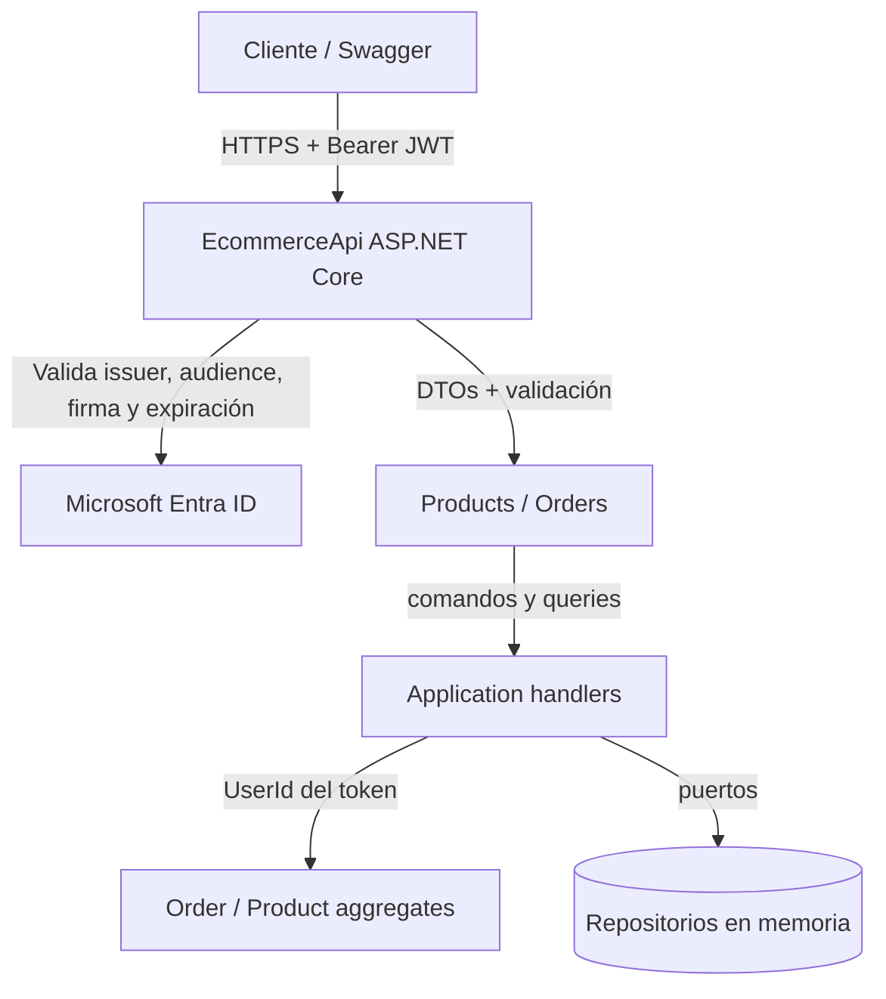

# Modelado de amenazas y AppSec — EcommerceApi

Análisis STRIDE y contraste con OWASP API Security Top 10 (2023) sobre el código
actual. Cada control incluye su estado real: **implementado**, **parcial** o
**pendiente**. No se presentan controles documentados como si estuvieran
desplegados en producción.

## 1. Alcance

`EcommerceApi` expone:

- `GET/POST /api/products`
- `GET/POST /api/orders`
- `GET /health` (anónimo)

Autenticación con JWT de Microsoft Entra ID. Almacenamiento en memoria
(`InMemoryProductRepository` e `InMemoryOrderRepository`), sin base de datos ni
alta disponibilidad. La lógica de aplicación vive en `EcommerceApi.Application` y
el dominio en `EcommerceApi.Domain`; los controladores solo orquestan handlers.

### Diagrama de flujo

## 2. STRIDE

| Categoría | Amenaza | Control actual | Estado |
|---|---|---|---|
| **Spoofing** | Token falsificado o expirado | `JwtBearer` valida firma (JWKS), `iss`, `aud`, `exp` y `nbf` | Implementado |
| **Tampering** | Modificación de payloads o mass assignment | DTOs de entrada, validación con DataAnnotations, HTTPS | Implementado |
| **Repudiation** | Usuario niega una operación | No hay auditoría persistente; solo logs de aplicación | Parcial |
| **Information Disclosure** | Fuga de IDs, stack traces o tokens | `UserId` no se serializa, `ProblemDetails`, Swagger solo en Development | Parcial |
| **Denial of Service** | Peticiones masivas o cuerpos enormes | Rate limit 120/min por IP, límite de 16 KB, límites del contenedor | Parcial |
| **Elevation of Privilege** | Usuario accede a pedidos ajenos | Filtrado por identidad y `404` para recursos ajenos | Implementado (BOLA) |
| **Elevation of Privilege** | Acceso a funciones administrativas | No hay roles/scopes aplicados; no existen endpoints admin | Pendiente / fuera de alcance |

## 3. OWASP API Security Top 10 (2023)

| Riesgo | Estado | Evidencia / limitación |
|---|---|---|
| **API1 BOLA** | Mitigado | `OrdersController` filtra por `UserId`; prueba `UserCannotReadAnotherUsersOrder` |
| **API2 Broken Authentication** | Mitigado | Entra ID + validación JWT; no se gestionan contraseñas |
| **API3 Broken Object Property Level Authorization** | Mitigado | `CreateProductRequest` y `CreateOrderRequest`; `Id`, `Total` y `UserId` no se aceptan del cliente |
| **API4 Unrestricted Resource Consumption** | Parcial | Rate limit y límite de cuerpo; sin cuotas por usuario ni WAF |
| **API5 Broken Function Level Authorization** | Pendiente | No hay políticas por scopes/roles; todos los endpoints requieren solo autenticación |
| **API6 Unrestricted Access to Sensitive Business Flows** | Pendiente | No hay antifraude, captcha ni límites de negocio |
| **API7 Server Side Request Forgery** | No aplica | La API no realiza peticiones salientes a URLs del usuario |
| **API8 Security Misconfiguration** | Parcial | CORS deny-by-default, headers, HTTPS/HSTS, contenedor no-root; faltan WAF y despliegue verificado |
| **API9 Improper Inventory Management** | Parcial | Swagger solo en Development; no hay inventario formal de versiones |
| **API10 Unsafe Consumption of APIs** | No aplica | No consume APIs de terceros |

## 4. Controles implementados en código

- Autenticación JWT con validación de firma, issuer, audience y lifetime.
- Autorización por identidad y aislamiento de pedidos (BOLA).
- DTOs para evitar mass assignment.
- Validación de entrada con DataAnnotations.
- CORS con allowlist y denegación por defecto.
- Rate limiting global por IP.
- Límite de tamaño de petición en escrituras.
- `ProblemDetails` y cabeceras `X-Content-Type-Options`, `X-Frame-Options`,
  `Referrer-Policy` y `Permissions-Policy`.
- Swagger confinado a `Development`.
- Contenedor multi-stage con usuario no-root.
- Pruebas de integración de autenticación, validación y BOLA.
- Pruebas unitarias de invariantes y handlers; regla de dependencias entre capas
  verificada en `tests/EcommerceApi.Architecture.Tests`.
- Invariantes de dominio (agregados `Order` y `Product`) que impiden persistir
  estados inconsistentes aunque la validación de transporte se relaje.

## 5. Riesgos residuales

1. **Sin persistencia**: los datos se pierden al reiniciar; no hay integridad
   transaccional ni backups. Sin outbox, un evento de dominio no sobrevive a un
   fallo entre la escritura y una futura publicación.
2. **Sin autorización granular**: no se validan scopes/roles por endpoint.
3. **Sin auditoría inmutable**: los logs no están centralizados ni firmados.
4. **Sin WAF/API Management**: el rate limit es local y por IP.
5. **Sin despliegue real**: la plantilla Bicep y los Private Endpoints no se han
   probado contra Azure.
6. **Sin pruebas de carga**: el límite de 120/min no se ha calibrado.
7. **Client credentials**: el claim `sub` identifica a la aplicación, no a una
   persona; las pruebas de usuario final requieren flujos delegados.

## 6. Verificación en CI

El pipeline `.github/workflows/devsecops-ci.yml` ejecuta:

1. **Secret scanning** con Gitleaks sobre historial completo.
2. **SAST** con CodeQL (`security-extended`).
3. **SCA** con Trivy, bloqueante para CRITICAL/HIGH.
4. **Container scan** con Trivy y verificación de usuario no-root.
5. **IaC scan** con Trivy config sobre `infra/`.
6. **Dependency Review** en pull requests.

Los resultados se publican como SARIF en GitHub Security.

## 7. Líneas de trabajo

- Implementar políticas de autorización por scopes/roles.
- Añadir auditoría persistente y correlación de `oid`/`sub`.
- Añadir pruebas de carga y calibración del rate limit.
- Desplegar la plantilla Bicep en una suscripción de laboratorio y validar
  Private Endpoints, DNS y diagnóstico.
- Añadir API Management/WAF delante de la API.
- Incorporar pruebas de seguridad de API (BOLA/BFLA) contra un entorno desplegado.
