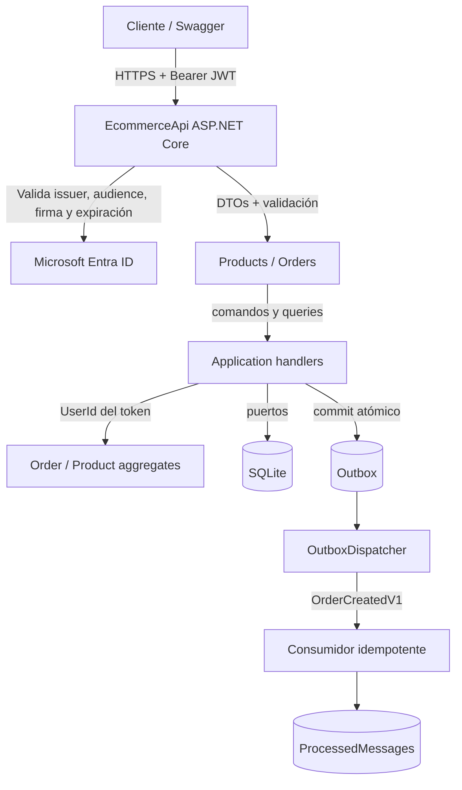

# Modelado de amenazas y AppSec — EcommerceApi

Antes de defender una casa conviene dibujar por dónde se puede entrar: puertas, ventanas y tejado. Este documento hace eso con la API —qué se puede falsificar, leer, alterar o tumbar— y contrasta el resultado con la lista de fallos más comunes en APIs (OWASP API Security Top 10, 2023). Cada control lleva su estado real: implementado, parcial o pendiente, y no se presenta como desplegado lo que solo está documentado.

## 1. Alcance

`EcommerceApi` expone:

- `GET/POST /api/products`
- `GET/POST /api/orders`
- `GET /health` (anónimo)

Autenticación con JWT de Microsoft Entra ID. Persistencia en **SQLite local** con **outbox transaccional** (el pedido y su aviso se guardan en la misma operación; `SqliteOrderRepository`, `SqliteProductRepository` y `SqliteOutboxStore`), sin alta disponibilidad ni backups. La lógica de aplicación vive en `EcommerceApi.Application` y el dominio en `EcommerceApi.Domain`; los controladores solo orquestan handlers (las clases que ejecutan cada caso de uso). El consumidor idempotente (`ProcessOrderHandler` + `ProcessedMessages`) se ejecuta en local: si el mismo mensaje llega dos veces, el efecto se aplica una sola vez; la Function y Service Bus están diseñados pero no desplegados.

### Diagrama de flujo

## 2. STRIDE

STRIDE agrupa las amenazas en seis familias: suplantación de identidad, manipulación de datos, repudio, fuga de información, denegación de servicio y elevación de privilegios. La tabla recorre cada una sobre este código.

| Categoría | Amenaza | Control actual | Estado |
|---|---|---|---|
| **Spoofing** | Token falsificado o expirado | `JwtBearer` valida firma (JWKS), `iss`, `aud`, `exp` y `nbf` | Implementado |
| **Tampering** | Modificación de payloads o mass assignment | DTOs de entrada, validación con DataAnnotations, HTTPS | Implementado |
| **Tampering** | Reenvío o duplicado de `OrderCreatedV1` | Idempotencia por `messageId` en `ProcessedMessages`; el outbox escribe el mensaje en la misma transacción que el pedido | Implementado (local) |
| **Repudiation** | Usuario niega una operación | No hay auditoría persistente; solo logs de aplicación | Parcial |
| **Information Disclosure** | Fuga de IDs, stack traces o tokens | `UserId` no se serializa, `ProblemDetails`, Swagger solo en Development | Parcial |
| **Denial of Service** | Peticiones masivas o cuerpos enormes | Rate limit 120/min por IP validado con carga puntual; límite de 16 KB sin comprobar; límites del contenedor | Parcial |
| **Elevation of Privilege** | Usuario accede a pedidos ajenos | Filtrado por identidad y `404` para recursos ajenos | Implementado (BOLA) |
| **Elevation of Privilege** | Acceso a funciones administrativas | No hay roles/scopes aplicados; no existen endpoints admin | Pendiente / fuera de alcance |

## 3. OWASP API Security Top 10 (2023)

| Riesgo | Estado | Evidencia / limitación |
|---|---|---|
| **API1 BOLA** | Mitigado | `OrdersController` filtra por `UserId`; prueba `UserCannotReadAnotherUsersOrder` |
| **API2 Broken Authentication** | Mitigado | Entra ID + validación JWT; no se gestionan contraseñas |
| **API3 Broken Object Property Level Authorization** | Mitigado | `CreateProductRequest` y `CreateOrderRequest`; `Id`, `Total` y `UserId` no se aceptan del cliente |
| **API4 Unrestricted Resource Consumption** | Parcial | Rate limit y límite de cuerpo; sin cuotas por usuario ni WAF |
| **API5 Broken Function Level Authorization** | Pendiente | No hay políticas por scopes/roles; todos los endpoints requieren solo autenticación |
| **API6 Unrestricted Access to Sensitive Business Flows** | Pendiente | No hay antifraude, captcha ni límites de negocio |
| **API7 Server Side Request Forgery** | No aplica | La API no realiza peticiones salientes a URLs del usuario |
| **API8 Security Misconfiguration** | Parcial | CORS deny-by-default, headers, HTTPS/HSTS, contenedor no-root; faltan WAF y despliegue verificado |
| **API9 Improper Inventory Management** | Parcial | Swagger solo en Development; no hay inventario formal de versiones |
| **API10 Unsafe Consumption of APIs** | No aplica | No consume APIs de terceros |

## 4. Controles implementados en código

La lista completa, con el archivo y la prueba de cada control, está en
[`capacidades.md`](capacidades.md#22-seguridad). Los que cambian este modelo de
amenaza son: validación JWT con `JwtBearer` (firma, emisor, audiencia y vigencia),
autorización por identidad con `404` para pedidos ajenos, DTOs de entrada contra
*mass assignment*, CORS denegado por defecto, *rate limit* global por IP, límite de
cuerpo en escrituras, `ProblemDetails` sin detalles internos en el `500`,
cabeceras de seguridad, Swagger solo en `Development`, contenedor no-root y
pruebas de integración de autenticación, validación y BOLA.

En profundidad: invariantes de dominio que impiden persistir estados
inconsistentes, importes en céntimos, paginación por cursor, outbox transaccional
y consumidor idempotente por `messageId`.

## 5. Riesgos residuales

1. **Persistencia de laboratorio**: SQLite no ofrece backups, réplica ni alta disponibilidad, y el esquema se crea con `CREATE TABLE IF NOT EXISTS` sin migraciones versionadas. El outbox y la idempotencia protegen la entrega, no la disponibilidad del almacén.
2. **Sin autorización granular**: no se validan scopes/roles por endpoint.
3. **Sin auditoría inmutable**: los logs no están centralizados ni firmados.
4. **Sin WAF/API Management**: el rate limit es local y por IP.
5. **Sin despliegue real**: la plantilla Bicep y los Private Endpoints no se han probado contra Azure.
6. **Sin SLO ni calibración**: el límite se probó bajo carga (10 y 50 peticiones/s), pero 120/min no se ha calibrado contra latencia ni coste por endpoint. El `413` del cuerpo de 16 KB tampoco se ha comprobado en ejecución.
7. **Client credentials**: el claim `sub` identifica a la aplicación, no a una persona; las pruebas de usuario final requieren flujos delegados.

## 6. Verificación en CI

El pipeline `.github/workflows/devsecops-ci.yml` ejecuta:

1. **Secret scanning** con Gitleaks sobre historial completo.
2. **SAST** con CodeQL (`security-extended`).
3. **SCA** con Trivy, bloqueante para CRITICAL/HIGH.
4. **Container scan** con Trivy y verificación de usuario no-root.
5. **IaC scan** con Trivy config sobre `infra/`.
6. **Dependency Review** en pull requests.

Los resultados se publican como SARIF en GitHub Security.

## 7. Líneas de trabajo

- Implementar políticas de autorización por scopes/roles.
- Añadir auditoría persistente y correlación de `oid`/`sub`.
- Calibrar el rate limit contra un SLO de latencia y el coste por endpoint.
- Desplegar la plantilla Bicep en una suscripción de laboratorio y validar
  Private Endpoints, DNS y diagnóstico.
- Añadir API Management/WAF delante de la API.
- Incorporar pruebas de seguridad de API (BOLA/BFLA) contra un entorno desplegado.
