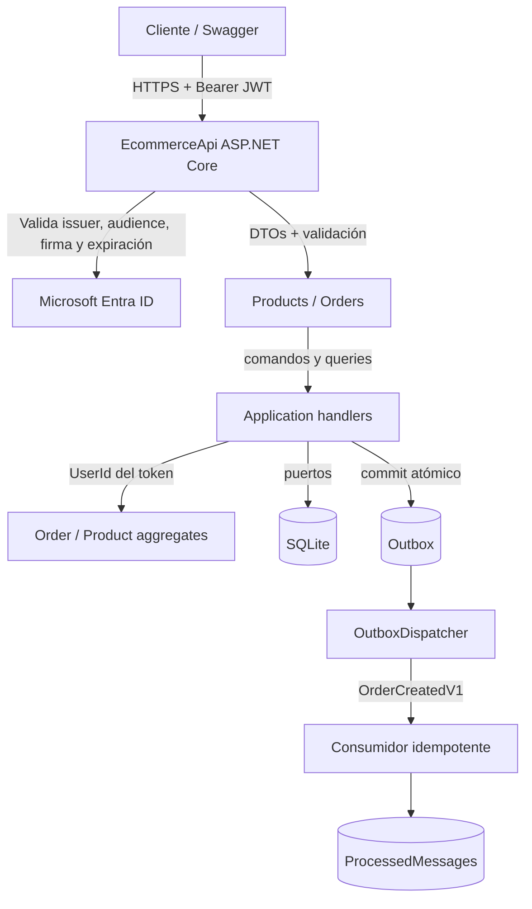

# Modelado de amenazas y AppSec — EcommerceApi

Antes de defender una casa conviene dibujar por dónde se puede entrar: puertas, ventanas y tejado. Este documento hace eso con la API —qué se puede falsificar, leer, alterar o tumbar— y contrasta el resultado con la lista de fallos más comunes en APIs (OWASP API Security Top 10, 2023). Cada control lleva su estado real: implementado, parcial o pendiente, y no se presenta como desplegado lo que solo está documentado.

## 1. Alcance

`EcommerceApi` expone:

- `GET/POST /api/products`
- `GET/POST /api/orders`
- `GET /health` (anónimo)

Autenticación con JWT de Microsoft Entra ID. Persistencia en **SQLite local** con **outbox transaccional** (el pedido y su aviso se guardan en la misma operación; `SqliteOrderRepository`, `SqliteProductRepository` y `SqliteOutboxStore`), sin alta disponibilidad ni backups. La lógica de aplicación vive en `EcommerceApi.Application` y el dominio en `EcommerceApi.Domain`; los controladores solo orquestan handlers (las clases que ejecutan cada caso de uso). El consumidor idempotente (`ProcessOrderHandler` + `ProcessedMessages`) se ejecuta en local: si el mismo mensaje llega dos veces, el efecto se aplica una sola vez; la Function y Service Bus están diseñados pero no desplegados.

### Diagrama de flujo

## 2. STRIDE

STRIDE agrupa las amenazas en seis familias: suplantación de identidad, manipulación de datos, repudio, fuga de información, denegación de servicio y elevación de privilegios. La tabla recorre cada una sobre este código.

| Categoría | Amenaza | Control actual | Estado |
|---|---|---|---|
| **Spoofing** | Token falsificado o expirado | `JwtBearer` valida firma (JWKS), `iss`, `aud`, `exp` y `nbf` | Implementado |
| **Tampering** | Modificación de payloads o mass assignment | DTOs de entrada, validación con DataAnnotations, HTTPS | Implementado |
| **Tampering** | Reenvío o duplicado de `OrderCreatedV1` | Idempotencia por `messageId` en `ProcessedMessages`; el outbox escribe el mensaje en la misma transacción que el pedido | Implementado (local) |
| **Repudiation** | Usuario niega una operación | No hay auditoría persistente; solo logs de aplicación | Parcial |
| **Information Disclosure** | Fuga de IDs, stack traces o tokens | `UserId` no se serializa, `ProblemDetails`, Swagger solo en Development | Parcial |
| **Denial of Service** | Peticiones masivas o cuerpos enormes | Rate limit 120/min por IP validado con carga puntual; límite de 16 KB validado en local (`413` a 17 KB); límites del contenedor | Parcial |
| **Elevation of Privilege** | Usuario accede a pedidos ajenos | Filtrado por identidad y `404` para recursos ajenos | Implementado (BOLA) |
| **Elevation of Privilege** | Acceso a funciones administrativas | No hay roles/scopes aplicados; no existen endpoints admin | Pendiente / fuera de alcance |

## 3. Activos y límites de confianza

La tabla de STRIDE dice qué puede salir mal; esta sección dice dónde acaba lo que el sistema controla. La **capa** es el proyecto que toca la frontera y el **radio de impacto**, lo que se pierde si esa frontera cede.

### 3.1 Activos

| Activo | Dónde vive hoy | Qué se pierde si cae |
|---|---|---|
| Token del cliente | cabecera `Authorization` del cliente | suplantación mientras siga vigente; firma y caducidad acotan la ventana |
| Configuración de Entra ID (`iss`, `aud`, JWKS) | configuración del host | se aceptarían tokens de otro emisor: cae el modelo de identidad entero |
| Pedidos y su `UserId` | SQLite | lectura y alteración de pedidos ajenos; filtrado por identidad y `404` |
| `OrderCreatedV1` y `ProcessedMessages` | outbox e idempotencia en SQLite | pedidos duplicados o inventados; escritura atómica y `messageId` |
| Credenciales de despliegue | pipeline, fuera del repo | tocar la suscripción; hoy no existen (OIDC diseñado, no activo) |
| Imagen publicada y workflows | GHCR (`container-publish.yml`) y `core`; el SBOM, en el artefacto de la ejecución | cadena de suministro; Gitleaks, Trivy, dependency-review, inventario SBOM CycloneDX, firma keyless y atestación del digest publicado |
| Identidad de agente (futuro) | por definir | ejecutar cambios de cloud con identidad propia; §4 |

### 3.2 Límites de confianza

| Frontera | Qué la cruza | Capa que la toca | Radio de impacto | Control |
|---|---|---|---|---|
| Cliente ↔ host | HTTPS con bearer JWT | host | la superficie entera de la API, actuando como ese usuario | `JwtBearer` (firma, `iss`, `aud`, `exp`), rate limit de 120/min, cuerpo de 16 KB, contenedor no-root |
| Host ↔ Entra ID | metadatos y claves públicas | host | validación de tokens de todo el proceso | firma comprobada en local; la caché de claves la aporta la librería, sin verificar aquí |
| Host ↔ Infrastructure | registro de dependencias del contenedor | host | cualquier adaptador que componga el proceso | `Controllers_DoNotDependOnInfrastructure`; la composición vive solo en `Program.cs` |
| Application ↔ Infrastructure | puertos (`IOrderRepository`, `IProductRepository`) | Application | los adaptadores, nunca el dominio | [ADR-0002](adr/0002-capas-y-regla-de-dependencias.md) y `LayerDependencyTests`, que impiden instanciar adaptadores fuera del host |
| Infrastructure ↔ SQLite y outbox | lectura y escritura del archivo | Infrastructure | el almacén entero, sin copia | volumen local y usuario no-root; SQLite es un archivo en proceso, no un servicio en red |
| Host ↔ Function y Service Bus | `OrderCreatedV1` | host e Infrastructure | consumidor idempotente | diseñado, no desplegado |
| Pipeline ↔ GHCR y Azure | imagen publicada y credenciales | CI | el registro o la suscripción | `GITHUB_TOKEN` con `packages: write` en `container-publish.yml`; OIDC a Azure diseñado, no activo |

La regla de dependencias no sustituye a una frontera de capacidad: `LayerDependencyTests` compara referencias de ensamblado, así que impide instanciar adaptadores desde `Domain` o `Application`, no llamar a la red del BCL desde ellos. Lo que sí fija es **dónde vive la decisión sensible** —la conexión, la configuración y el host— y con ello qué contiene cada capa cuando una cede: la contención es máxima arriba, donde no hay credenciales ni conexiones que perder, y mínima en el host, que tiene todas, de modo que su radio de impacto es el proceso entero. `Contracts` no cruza ninguna frontera: son tipos de datos, sin entrada ni salida.

### 3.3 Lo que todavía no existe

- No hay frontera real entre el host y Azure: no hay nada desplegado.
- No hay identidad de carga de trabajo ni Managed Identity; la persistencia es un archivo local.
- No hay segregación por usuario en el almacén: el aislamiento es lógico, en el controlador.

## 4. Un agente que escribe código de cloud y lo ejecuta

Hasta ahora la amenaza tenía forma humana. Un agente escribe Bicep o comandos de `az`, los ejecuta y reintenta hasta que algo pasa la prueba; no necesita mala intención para publicar un `0.0.0.0/0`, solo elegir el camino que le funciona. El límite de confianza es el mismo de §3, pero quien lo cruza ya no es una persona delante de la pantalla: es una identidad con permisos.

| Lo que puede hacer | Qué lo frena | Estado |
|---|---|---|
| Leer toda la suscripción | el rol de su principal | Pendiente: no hay principal |
| Crear recursos con coste | presupuesto con alerta y política que deniegue SKUs caras | Pendiente |
| Abrir un puerto para «comprobar que va» | política que deniegue entrada pública y revisión del diff de red | Pendiente |
| Escribir un secreto en el repositorio | Gitleaks sobre el historial completo, en CI | Validado |
| Escribir un secreto en un log | redacción en el código y revisión del registro | Pendiente: sin control verificado |
| Reemplazar o borrar recursos (`--mode Complete`) | `what-if` y aprobación humana antes de aplicar | Pendiente |
| Actuar contra una cuenta real que no es de laboratorio | suscripción separada y RBAC acotado a un grupo de recursos | Pendiente |

La regla que se propone: un agente no hereda credenciales de persona, sino un principal propio, de corta duración por OIDC y acotado a un grupo de recursos, sin escritura sobre red ni sobre IAM. Todo `apply` pasa por `what-if` y lo aprueba una persona, porque el freno son el presupuesto y las políticas, no la buena intención del prompt. Su radio de impacto debe ser el grupo de recursos, nunca la suscripción ni el inquilino.

Estado: **Diseño**, no despliegue. No hay suscripción, ni OIDC activo, ni identidad de agente; lo único Validado es la puerta que impide que el código llegue con secretos.

## 5. OWASP API Security Top 10 (2023)

| Riesgo | Estado | Evidencia / limitación |
|---|---|---|
| **API1 BOLA** | Mitigado | `OrdersController` filtra por `UserId`; prueba `UserCannotReadAnotherUsersOrder` |
| **API2 Broken Authentication** | Mitigado | Entra ID + validación JWT; no se gestionan contraseñas |
| **API3 Broken Object Property Level Authorization** | Mitigado | `CreateProductRequest` y `CreateOrderRequest`; `Id`, `Total` y `UserId` no se aceptan del cliente |
| **API4 Unrestricted Resource Consumption** | Parcial | Rate limit y límite de cuerpo; sin cuotas por usuario ni WAF |
| **API5 Broken Function Level Authorization** | Pendiente | No hay políticas por scopes/roles; todos los endpoints requieren solo autenticación |
| **API6 Unrestricted Access to Sensitive Business Flows** | Pendiente | No hay antifraude, captcha ni límites de negocio |
| **API7 Server Side Request Forgery** | No aplica | La API no realiza peticiones salientes a URLs del usuario |
| **API8 Security Misconfiguration** | Parcial | CORS deny-by-default, headers, HTTPS/HSTS, contenedor no-root; faltan WAF y despliegue verificado |
| **API9 Improper Inventory Management** | Parcial | Swagger solo en Development; no hay inventario formal de versiones |
| **API10 Unsafe Consumption of APIs** | No aplica | No consume APIs de terceros |

## 6. Controles implementados en código

La lista completa, con el archivo y la prueba de cada control, está en
[`capacidades.md`](capacidades.md#22-seguridad). Los que cambian este modelo de
amenaza son: validación JWT con `JwtBearer` (firma, emisor, audiencia y vigencia),
autorización por identidad con `404` para pedidos ajenos, DTOs de entrada contra
*mass assignment*, CORS denegado por defecto, *rate limit* global por IP, límite de
cuerpo en escrituras, `ProblemDetails` sin detalles internos en el `500`,
cabeceras de seguridad, Swagger solo en `Development`, contenedor no-root y
pruebas de integración de autenticación, validación y BOLA.

En profundidad: invariantes de dominio que impiden persistir estados
inconsistentes, importes en céntimos, paginación por cursor, outbox transaccional
y consumidor idempotente por `messageId`.

## 7. Riesgos residuales

1. **Persistencia de laboratorio**: SQLite no ofrece backups, réplica ni alta disponibilidad, y el esquema se crea con `CREATE TABLE IF NOT EXISTS` sin migraciones versionadas. El outbox y la idempotencia protegen la entrega, no la disponibilidad del almacén.
2. **Sin autorización granular**: no se validan scopes/roles por endpoint.
3. **Sin auditoría inmutable**: los logs no están centralizados ni firmados.
4. **Sin WAF/API Management**: el rate limit es local y por IP.
5. **Sin despliegue real**: la plantilla Bicep y los Private Endpoints no se han probado contra Azure.
6. **Sin SLO ni calibración**: el límite se probó bajo carga (10 y 50 peticiones/s), pero 120/min no se ha calibrado contra latencia ni coste por endpoint. El `413` del cuerpo de 16 KB se validó en local el 2026-11-12; el SLO sigue pendiente.
7. **Client credentials**: el claim `sub` identifica a la aplicación, no a una persona; las pruebas de usuario final requieren flujos delegados.
8. **Sin identidad de agente ni presupuesto**: si un agente ejecuta cambios de cloud con la credencial de una persona, su radio de impacto es la suscripción entera y nada lo frena. Hoy no hay suscripción; el diseño de §4 no está aplicado.

## 8. Verificación en CI

El pipeline `.github/workflows/devsecops-ci.yml` ejecuta:

1. **Secret scanning** con Gitleaks sobre historial completo.
2. **SAST** con CodeQL (`security-extended`).
3. **SCA** con Trivy, bloqueante para CRITICAL/HIGH.
4. **Container scan** con Trivy y verificación de usuario no-root.
5. **IaC scan** con Trivy config sobre `infra/`.
6. **Dependency Review** en pull requests.

Los resultados se publican como SARIF en GitHub Security.

El workflow `.github/workflows/container-publish.yml` publica la imagen, genera el SBOM CycloneDX de ese mismo digest y lo adjunta a la ejecución. No evalúa vulnerabilidades: es el inventario de lo que contiene la imagen. La firma y la atestación se validaron en el run [43314295991](https://github.com/lanuzalorenzo/lab-api-local-azure/actions/runs/43314295991): `cosign verify` y `cosign verify-attestation` en verde contra el digest publicado.

## 9. Líneas de trabajo

- Implementar políticas de autorización por scopes/roles.
- Añadir auditoría persistente y correlación de `oid`/`sub`.
- Calibrar el rate limit contra un SLO de latencia y el coste por endpoint.
- Desplegar la plantilla Bicep en una suscripción de laboratorio y validar
  Private Endpoints, DNS y diagnóstico.
- Añadir API Management/WAF delante de la API.
- Incorporar pruebas de seguridad de API (BOLA/BFLA) contra un entorno desplegado.
- Definir el principal del agente (OIDC, un grupo de recursos, sin red ni IAM) con presupuesto y `what-if` obligatorio.
