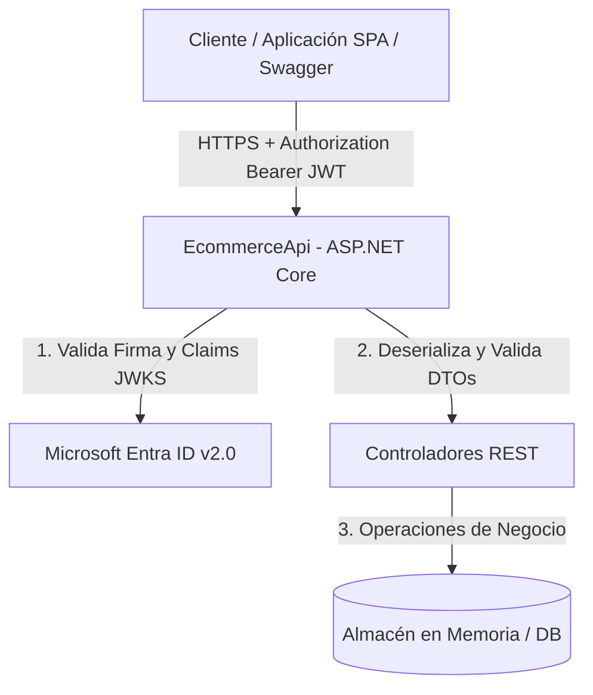

# 🛡️ Modelado de Amenazas y Seguridad en Aplicaciones (AppSec)

Este documento detalla el análisis de seguridad y el modelado de amenazas realizado sobre **EcommerceApi**, aplicando el marco **STRIDE** y contrastando la arquitectura contra el **OWASP API Security Top 10 (2023)**.

---

## 1. Alcance y Arquitectura de la API

`EcommerceApi` expone endpoints REST para la consulta de catálogo (`ProductsController`) y la gestión de compras (`OrdersController`), integrando autenticación mediante tokens JWT emitidos por **Microsoft Entra ID**.

### Diagrama de Flujo de Datos (DFD)

---

## 2. Análisis de Amenazas STRIDE

| Categoría STRIDE | Amenaza identificada | Vector de ataque | Control de mitigación implementado |
|---|---|---|---|
| **Spoofing (Suplantación)** | Cliente ilegítimo haciéndose pasar por un usuario autenticado. | Envío de tokens JWT falsificados o reutilización de tokens expirados. | Middleware `JwtBearer` con validación estricta de firma criptográfica mediante JWKS de Microsoft, `ValidateIssuer`, `ValidateAudience` y `ValidateLifetime`. |
| **Tampering (Manipulación)** | Modificación de datos durante el tránsito o en payloads JSON. | Interceptación de tráfico HTTP o inyección de propiedades no autorizadas. | Exigencia de HTTPS (`UseHttpsRedirection`), validación estricta de esquemas y uso de DTOs específicos (`CreateOrderRequest`) para evitar sobreasignación (Mass Assignment). |
| **Repudiation (Repudio)** | Un usuario niega haber creado un pedido o modificado stock. | Falta de trazabilidad en operaciones de escritura. | Registro de eventos estructurados con correlación de identificadores de usuario (`oid`/`sub` del JWT) en logs de auditoría. |
| **Information Disclosure (Fuga de información)** | Exposición de identificadores de tenant, secretos o stack traces en respuestas HTTP. | Errores no controlados de la API o cabeceras informativas del servidor. | Entorno de producción sin Swagger activo (`app.Environment.IsDevelopment()`), manejo centralizado de excepciones y deshabilitación de cabeceras redundantes (`X-Powered-By`). |
| **Denial of Service (Denegación de servicio)** | Saturación de memoria por peticiones masivas sin límite. | Petición repetida de pedidos con arrays masivos de productos o consultas exhaustivas. | Validación de cardinalidad mínima y máxima en `ProductIds`, y límite de asignación de recursos en contenedor Docker. |
| **Elevation of Privilege (Elevación de privilegios)** | Usuario estándar ejecutando acciones administrativas. | Llamada a endpoints de modificación sin control de roles. | Implementación de atributos `[Authorize]` y segregación futura por roles/scopes (`[Authorize(Roles = "Admin")]`). |

---

## 3. Mapeo contra OWASP API Security Top 10 (2023)

### API1:2023 — Broken Object Level Authorization (BOLA / IDOR)
- **Riesgo:** Un usuario autenticado consulta el pedido de otro usuario cambiando el `{id}` en `GET /api/orders/{id}`.
- **Estado en la API:** El controlador `OrdersController` verifica la existencia del pedido.
- **Medida recomendada en código:** Correlacionar el ID del pedido con el claim de identidad (`User.FindFirst(ClaimTypes.NameIdentifier)`) antes de retornar el recurso.

### API2:2023 — Broken Authentication
- **Mitigación:** Se delega la autenticación a Microsoft Entra ID mediante el estándar **OAuth 2.0 con PKCE**. La API no gestiona credenciales ni contraseñas de usuarios finales; únicamente valida tokens firmados asimétricamente (RSA/ECDSA).

### API3:2023 — Broken Object Property Level Authorization (Mass Assignment)
- **Mitigación:** En lugar de enlazar directamente el modelo de dominio `Order` en `POST /api/orders`, se utiliza el DTO `CreateOrderRequest` que solo expone `ProductIds`, impidiendo que un atacante manipule campos como `TotalAmount`, `CreatedAt` o `Status`.

### API4:2023 — Unrestricted Resource Consumption
- **Mitigación:** A nivel de aplicación, validación de listas vacías o saturadas. A nivel de infraestructura (Docker/Azure), límites de CPU y memoria (`resources.limits`) para contener cualquier impacto de DoS.

### API5:2023 — Broken Function Level Authorization (BFLA)
- **Mitigación:** Políticas de autorización basadas en scopes (`scp`) y roles de aplicación (`roles`) asignados en el registro de Entra ID.

### API8:2023 — Security Misconfiguration
- **Mitigación:**
  - Contenedor Docker configurado para ejecutar con usuario no privilegiado (`USER $APP_UID`).
  - CORS configurado explícitamente.
  - Swagger UI confinado exclusivamente al entorno `Development`.

---

## 4. Prácticas DevSecOps de Verificación Automática

La postura de seguridad de esta API se valida de forma continua en cada commit mediante el pipeline [`.github/workflows/devsecops-ci.yml`](../.github/workflows/devsecops-ci.yml):
1. **Secret Scanning:** Bloqueo de commits con credenciales o claves expuestas mediante **Gitleaks**.
2. **SCA (Software Composition Analysis):** Detección de vulnerabilidades en paquetes NuGet con **Trivy**.
3. **Container Image Hardening:** Escaneo de la imagen Docker para asegurar la ausencia de paquetes vulnerables a nivel de sistema operativo base.
