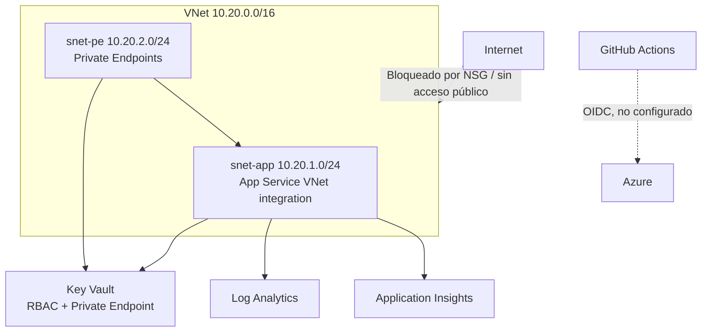

# Infraestructura de referencia — EcommerceApi

Plantilla Bicep que describe un despliegue de referencia para la API. **No se ha
desplegado en una suscripción real**: se valida con `bicep build` y con Trivy
config en el pipeline. No contiene secretos ni identificadores reales.

## Arquitectura



## Recursos

| Recurso | Configuración de seguridad |
|---|---|
| VNet | Segmentación `snet-app` / `snet-pe` |
| NSG | Solo 443 desde la VNet; denegación por defecto |
| Key Vault | RBAC, purge protection, 90 días de retención, acceso público deshabilitado |
| App Service | HTTPS only, TLS 1.2, FTPS deshabilitado, HTTP/2, identidad gestionada |
| Private Endpoints | Key Vault (`vault`) y App Service (`sites`) |
| Private DNS | `privatelink.vaultcore.azure.net`, `privatelink.azurewebsites.net` |
| Log Analytics | Diagnóstico de App Service y Key Vault |
| Application Insights | Telemetría de la API |
| RBAC | La identidad de la API recibe *Key Vault Secrets User* |

## Validación local

```bash
bicep build infra/main.bicep --outfile /tmp/main.json
bicep lint infra/main.bicep
```

## Despliegue (cuando exista una suscripción)

```bash
az group create --name rg-ecomlab --location westeurope

az deployment group create \
  --resource-group rg-ecomlab \
  --template-file infra/main.bicep \
  --parameters infra/main.parameters.example.json
```

Antes de desplegar, sustituye los placeholders de `main.parameters.example.json`
por valores reales. No subas ese archivo con identificadores reales.

## OIDC de GitHub Actions a Azure (diseño, no activo)

El repositorio no incluye un workflow de despliegue. Para añadirlo de forma segura:

1. Crea una identidad federada en Entra ID para el repositorio.
2. Asigna permisos mínimos sobre el grupo de recursos.
3. Guarda `AZURE_CLIENT_ID`, `AZURE_TENANT_ID` y `AZURE_SUBSCRIPTION_ID` como
   variables del repositorio (no secretos de larga duración).
4. Usa `azure/login@v2` con `permissions: id-token: write`:

```yaml
permissions:
  id-token: write
  contents: read

steps:
  - uses: actions/checkout@v4
  - uses: azure/login@v2
    with:
      client-id: ${{ vars.AZURE_CLIENT_ID }}
      tenant-id: ${{ vars.AZURE_TENANT_ID }}
      subscription-id: ${{ vars.AZURE_SUBSCRIPTION_ID }}
```

No se incluye este workflow porque el repositorio no tiene una suscripción de
Azure asociada y no se ha validado el despliegue.

## Limitaciones

- La plantilla usa una SKU `P1v3`; el coste no se ha estimado.
- No incluye WAF, API Management, base de datos ni backup.
- La integración VNet de App Service requiere que la subred esté delegada y que
  el plan sea compatible (PremiumV3).
- El Private Endpoint de App Service y el acceso público deshabilitado deben
  probarse en un despliegue real.
